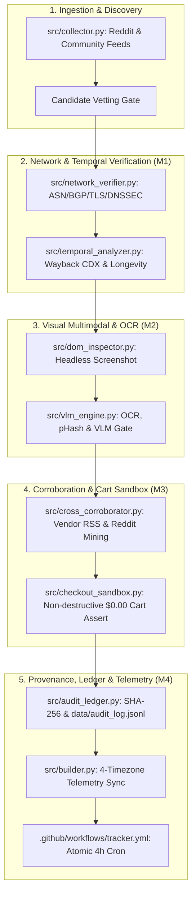

# Project: CertPulse Next-Gen Authenticity Verification Engine

## Architecture

CertPulse Next-Gen Authenticity Verification Engine elevates certification tracking beyond DOM regex by establishing a 7-tier verification architecture:
1. **Network Provenance & Cryptographic Origin (Tier 1)**: Autonomous System Number (ASN) & BGP route lookup via DNS-over-HTTPS (DoH) / Team Cymru TXT / RDAP; direct TLS X.509 certificate parsing for embedded RFC 6962 Signed Certificate Timestamps (SCTs); DNSSEC AD flag validation and CAA record verification.
2. **Temporal & Longevity Analysis (Tier 2)**: Wayback Machine CDX API temporal analysis, Anti-Fly-by-Night domain age scoring (<60 days penalized), and multi-year promotion recurrence classification with local persistent caching.
3. **Multimodal Visual & OCR Verification (Tier 3)**: Viewport screenshot capturing via headless Playwright, perceptual hashing (dHash/pHash) via native PIL+SciPy DCT against official vendor emblems, 3-tier progressive OCR engine, and rigid Pydantic V2 `VLMSemanticVerdict` evaluation with deterministic heuristic fallback.
4. **Cross-Source Ground-Truth Corroboration (Tier 4)**: Official vendor RSS/Atom feed indexing (AWS, Azure, GCP, Cisco) with domain whitelist and anti-clickbait filters; Reddit community sentiment mining (r/AWSCertifications, r/AzureCertification) for positive redemptions and negative closure cluster detection ($\ge 2$ reports within 48h).
5. **Ephemeral Synthetic Cart Sandbox (Tier 5)**: Sandboxed Playwright incognito checkout emulation with non-destructive route abortion (`blockedbyclient` on submission endpoints) and mathematical invariant assertion ($\text{Cart Total} === \$0.00\text{ USD}$) with structured triage states (`Review Needed: Copay Required`).
6. **Cryptographic Proof Ledger (Tier 6)**: SHA-256 binary digesting of rendered DOM snapshots and screenshot PNGs; append-only `data/audit_log.jsonl` with strict non-decreasing invariants.
7. **Pipeline Synchronization & 4-Timezone Telemetry (Tier 7)**: Atomic 5-artifact state synchronization across `data/offers.json`, `data/news.json`, `data/audit_log.jsonl`, `README.md`, `docs/index.html`; fix `.github/workflows/tracker.yml` line 54 to include `data/*.jsonl`; synchronized 4-timezone world telemetry (UTC, IST, EDT/EST, CEST/CET) with live UI clocks and README tables.



---

## Feature Inventory

Every feature identified across all 7 architectural tiers from the Survey phase is mapped to an assigned milestone:

| # | Feature | Description | Milestone | Source |
|---|---------|-------------|-----------|--------|
| 1 | ASN / BGP Route Origin Audit | Resolve IP and query ASN via Cymru TXT over DoH and RDAP against vendor ASN directory | M1 | ORIGINAL_REQUEST §Tier 1 |
| 2 | TLS Certificate Transparency (CT) Verification | Direct TLS handshake X.509 RFC 6962 embedded SCT extraction via `cryptography.x509` | M1 | ORIGINAL_REQUEST §Tier 1 |
| 3 | DNSSEC & CAA Record Verification | Query RFC 8484 AD flag and Type 257 CAA records via DoH for authorized vendor sponsorship | M1 | ORIGINAL_REQUEST §Tier 1 |
| 4 | Wayback Machine CDX API Integration | Query `web.archive.org/cdx/search/cdx` with persistent local caching in `data/temporal_longevity_cache.json` | M1 | ORIGINAL_REQUEST §Tier 2 |
| 5 | Anti-Fly-by-Night Longevity Scoring | Compute domain age in days; heavily penalize newly minted domains (<60 days) lacking archive footprint | M1 | ORIGINAL_REQUEST §Tier 2 |
| 6 | Seasonal Promotion Recurrence Classifier | Classify multi-year recurring promotional windows vs one-off anomalies | M1 | ORIGINAL_REQUEST §Tier 2 |
| 7 | Native Perceptual Hashing (dHash/pHash) | Native PIL + SciPy DCT perceptual hash computation against official vendor emblems | M2 | ORIGINAL_REQUEST §Tier 3 |
| 8 | 3-Tier Progressive OCR Engine | Tesseract -> EasyOCR -> SVG/DOM text contrast extraction heuristic fallback | M2 | ORIGINAL_REQUEST §Tier 3 |
| 9 | Multimodal VLM Semantic Gate & Heuristic Fallback | Rigid Pydantic V2 `VLMSemanticVerdict` schema with live VLM gate and deterministic offline heuristic fallback | M2 | ORIGINAL_REQUEST §Tier 3 |
| 10 | Authoritative Vendor Blog & RSS Ingestion | Index AWS, Microsoft, Google, Cisco blogs with FQDN whitelists and anti-clickbait filters | M3 | ORIGINAL_REQUEST §Tier 4 |
| 11 | Reddit Redemption & Closure Sentiment Mining | Detect positive redemption ("worked 100%") and negative closure clusters ($\ge 2$ reports -> `Registrations Closed`) | M3 | ORIGINAL_REQUEST §Tier 4 |
| 12 | Non-Destructive Checkout Sandbox | Ephemeral Playwright incognito context with route interception aborting final submission endpoints | M3 | ORIGINAL_REQUEST §Tier 5 |
| 13 | Zero-Dollar Mathematical Invariant | Assert cart balance === $0.00 USD; triage partial discounts with copays (e.g. Juniper $50) to `Review Needed` | M3 | ORIGINAL_REQUEST §Tier 5 |
| 14 | SHA-256 Binary & DOM Digesting | Compute 64-character lowercase hex digests of cleaned DOM snapshots and screenshot PNGs | M4 | ORIGINAL_REQUEST §Tier 6 |
| 15 | Append-Only Cryptographic Audit Ledger | Append verification records to `data/audit_log.jsonl` enforcing monotonically non-decreasing line count | M4 | ORIGINAL_REQUEST §Tier 6 |
| 16 | GitHub Actions Workflow Sync Fix | Fix `.github/workflows/tracker.yml` line 54 `file_pattern` to include `data/*.jsonl` | M4 | ORIGINAL_REQUEST §Tier 7 |
| 17 | 4-Timezone World Telemetry Sync | Synchronize UTC, IST (Asia/Kolkata), EDT/EST (America/New_York), CEST/CET (Europe/Berlin) across README and UI | M4 | ORIGINAL_REQUEST §Tier 7 |
| 18 | Dual Credential Segmentation Preservation | Preserve strict separation of Written Proctored Exams vs Unproctored Skill Badges | M4 | ORIGINAL_REQUEST §R1 |
| 19 | End-to-End Opaque-Box Test Suite | Comprehensive 4-tier test suite (Feature, Boundary, Combinatorial, Real-World Scenarios) | M5 | TEST_INFRA.md |
| 20 | Adversarial Coverage Hardening | White-box stress testing, monkeypatch fault injection, and edge-case hardening | M5 | Project Pattern §Phase 2 |

---

## Milestones

| # | Name | Scope | Dependencies | Status |
|---|------|-------|-------------|--------|
| M1 | Network Provenance & Temporal Longevity Engine | Tiers 1 & 2: `src/network_verifier.py`, `src/temporal_analyzer.py`, `data/temporal_longevity_cache.json`, integration into `src/authenticity.py` and `src/models.py` | none | DONE |
| M2 | Multimodal Visual Verification, OCR & pHash Engine | Tier 3: `src/visual_hasher.py`, `src/vlm_engine.py`, integration into `src/dom_inspector.py`, `src/models.py` | M1 | IN_PROGRESS |
| M3 | Ground-Truth Cross-Corroboration & Cart Sandbox | Tiers 4 & 5: `src/cross_corroborator.py`, `src/checkout_sandbox.py`, integration into `src/collector.py`, `src/news_collector.py`, `src/truth_oracle.py` | M1, M2 | PLANNED |
| M4 | Cryptographic Ledger, Pipeline Sync & 4-TZ Telemetry | Tiers 6 & 7: `src/audit_ledger.py`, `data/audit_log.jsonl`, `src/builder.py`, `src/main.py`, `.github/workflows/tracker.yml`, `docs/index.html`, `README.md` | M1, M2, M3 | PLANNED |
| M5 | E2E Verification & Adversarial Coverage Hardening | Comprehensive test suite (Tiers 1-4) and adversarial white-box hardening (Tier 5); 100% test pass rate | M1, M2, M3, M4 | PLANNED |

---

## Interface Contracts

### M1 (`src/network_verifier.py` & `src/temporal_analyzer.py`) ↔ Core Models (`src/models.py`)
```python
class NetworkProvenance(BaseModel):
    asn: Optional[int] = None
    asn_org: Optional[str] = None
    ip_address: Optional[str] = None
    is_vendor_infra: bool = True
    tls_ct_verified: bool = True
    sct_count: int = 0
    dnssec_valid: bool = False
    caa_authorized: bool = True
    verified_at_utc: str

class TemporalLongevity(BaseModel):
    first_seen_archive_utc: Optional[str] = None
    domain_age_days: Optional[int] = None
    snapshot_count: int = 0
    is_anti_fly_by_night_passed: bool = True
    is_seasonal_recurrent: bool = False
    verified_at_utc: str
```

### M2 (`src/visual_hasher.py` & `src/vlm_engine.py`) ↔ Inspection Engine (`src/dom_inspector.py`)
```python
class VLMSemanticVerdict(BaseModel):
    is_official_vendor: bool
    has_zero_dollar_waiver: bool
    requires_payment_or_copay: bool
    copay_amount_usd: float = 0.0
    registration_status: Literal["open", "waitlist", "closed", "cohort_full"]
    visual_confidence_score: float = Field(ge=0.0, le=1.0)
    badge_phash_matched: bool = False
    ocr_text_snippet: Optional[str] = None
```

### M3 (`src/cross_corroborator.py` & `src/checkout_sandbox.py`) ↔ Collector & Oracle (`src/collector.py`, `src/truth_oracle.py`)
```python
class CartEmulationResult(BaseModel):
    portal_type: str
    cart_balance_usd: float
    is_zero_dollar: bool
    copay_detected: bool
    submission_intercepted: bool = True
    status_verdict: str
```

### M4 (`src/audit_ledger.py`) ↔ Pipeline Persistence (`data/audit_log.jsonl`)
```python
class AuditLogEntry(BaseModel):
    timestamp_utc: str
    offer_id: str
    sha256_dom: str  # 64-character lowercase hex
    sha256_screenshot: str  # 64-character lowercase hex
    asn_verified: bool
    asn_number: Optional[int] = None
    vlm_score: Optional[float] = None
    status_assigned: str
```

---

## Code Layout

```
src/
├── network_verifier.py      # Tier 1: ASN/BGP/TLS/DNSSEC verification (M1)
├── temporal_analyzer.py     # Tier 2: Wayback CDX & longevity scoring (M1)
├── visual_hasher.py         # Tier 3: Native dHash/pHash badge matching (M2)
├── vlm_engine.py            # Tier 3: OCR & VLM evaluation gate with fallback (M2)
├── cross_corroborator.py    # Tier 4: Vendor RSS & Reddit sentiment mining (M3)
├── checkout_sandbox.py      # Tier 5: Ephemeral $0.00 cart sandbox (M3)
├── audit_ledger.py          # Tier 6: SHA-256 digesting & JSONL ledger (M4)
├── authenticity.py          # Domain & protocol verification (integrates M1)
├── dom_inspector.py         # Headless inspection & screenshot proof (integrates M2, M3)
├── inspector.py             # URL inspection runner (integrates M1-M4)
├── collector.py             # Candidate lead ingestion (integrates M3)
├── news_collector.py        # Feed news ingestion (integrates M3)
├── truth_oracle.py          # Truth policy oracle (integrates M3)
├── builder.py               # Multiview compiler & 4-timezone telemetry (M4)
├── main.py                  # Pipeline orchestrator (integrates M1-M4)
└── models.py                # Pydantic V2 data contracts (extended across M1-M4)

data/
├── offers.json              # 39 tracked active and historical offers
├── candidates.json          # Queue of candidate leads
├── news.json                # Dispatches from vendor channels
├── audit_log.jsonl          # Append-only cryptographic audit ledger (Tier 6)
└── temporal_longevity_cache.json # Local persistent cache for Wayback CDX (Tier 2)

tests/
├── test_invariants.py       # Core mathematical invariants
├── test_network_provenance.py # M1 invariant & unit tests
├── test_temporal_longevity.py # M1 CDX & longevity tests
├── test_visual_multimodal.py  # M2 OCR, pHash & VLM tests
├── test_corroboration_cart.py # M3 RSS, Reddit & cart tests
├── test_audit_ledger.py     # M4 SHA-256 & JSONL ledger tests
└── test_e2e_verification.py # M5 end-to-end integration & adversarial tests
```
