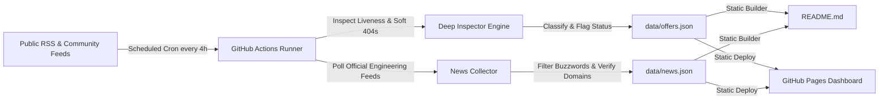

# CertPulse: Autonomous Free Cloud & Tech Certification Tracker

> **Automated, 100% free, and self-updating repository** tracking verified 100% free certification exam vouchers, accredited micro-credentials, and continuing education credits across AWS, Azure, Google Cloud, Cisco, ISC2, Oracle, Linux Foundation, Snowflake, and GitHub.

 
 
 
 

---

## Executive Summary

| Metric | Value | Definition |
| :--- | :--- | :--- |
| **Active Opportunities** | **14** | Verified 100% free exams & live registration windows |
| **Total Financial Value** | **$2,188 USD** | Aggregate savings if claimed today |
| **Historical Archive Tracked** | **8 Campaigns** | Past promotional cycles & recurrence roadmaps |
| **Verified Tech Dispatches** | **20 Reports** | Official primary cloud engineering updates |
| **Last Automated Inspection** | `2026-10-14 14:30 UTC` | Auto-audited for 404s and 'Closed' notices |
| **Hosting & Compute Cost** | **$0.00 / Month** | 100% native to GitHub Actions & GitHub Pages |

---

## Verified Active Certification Offers

### Security

| Provider | Certification & Program | Type | Value (USD) | Status | Claim Link |
| :--- | :--- | :--- | :---: | :---: | :--- |
| **ISC2** | Certified in Cybersecurity (CC) | `100% Free Exam Voucher` | $199 | 🟢 Active | [**Claim Offer**](https://www.isc2.org/landing/1mcc) |
| **Qualys** | Vulnerability Management & CSAM Specialist | `100% Free Credential` | $150 | 🟢 Active | [**Claim Offer**](https://www.qualys.com/training) |
| **Fortinet** | Fortinet Certified Fundamentals (FCF) | `100% Free Credential` | $100 | 🟢 Active | [**Claim Offer**](https://www.fortinet.com/training/cybersecurity-professionals) |

### Cloud & Data

| Provider | Certification & Program | Type | Value (USD) | Status | Claim Link |
| :--- | :--- | :--- | :---: | :---: | :--- |
| **Oracle Cloud** | OCI Foundations & Associate Certifications | `100% Free Exam Voucher` | $245 | 🟢 Active | [**Claim Offer**](https://education.oracle.com/oracle-cloud-infrastructure) |

### Cloud & AI

| Provider | Certification & Program | Type | Value (USD) | Status | Claim Link |
| :--- | :--- | :--- | :---: | :---: | :--- |
| **Microsoft Azure** | Microsoft Applied Skills (Azure, AI, Power Platform) | `100% Free Credential` | $100 | 🟢 Active | [**Claim Offer**](https://learn.microsoft.com/en-us/credentials/applied-skills/) |
| **Google Cloud** | Google Cloud Skill Badges & Arcade Milestones | `Free Skill Badges & Swag` | $100 | 🟢 Active | [**Claim Offer**](https://www.cloudskillsboost.google/) |

### DevOps & Cloud Native

| Provider | Certification & Program | Type | Value (USD) | Status | Claim Link |
| :--- | :--- | :--- | :---: | :---: | :--- |
| **Linux Foundation / CNCF** | Certified Kubernetes Administrator (CKA) / LFCS | `100% Free Scholarship Voucher` | $395 | 🟢 Active | [**Claim Offer**](https://www.linuxfoundation.org/about/lift-scholarships) |

### AI & Data

| Provider | Certification & Program | Type | Value (USD) | Status | Claim Link |
| :--- | :--- | :--- | :---: | :---: | :--- |
| **Snowflake** | Snowflake Data Warehousing & Data Applications Badges | `100% Free Credential` | $150 | 🟢 Active | [**Claim Offer**](https://learn.snowflake.com/en/) |
| **MongoDB** | MongoDB Associate Developer / DBA | `Free Training & Student Voucher` | $150 | 🟢 Active | [**Claim Offer**](https://learn.mongodb.com/) |

### CRM & Cloud

| Provider | Certification & Program | Type | Value (USD) | Status | Claim Link |
| :--- | :--- | :--- | :---: | :---: | :--- |
| **Salesforce** | Salesforce Certified Administrator / App Builder | `Quest Sweepstakes Voucher` | $200 | 🟢 Active | [**Claim Offer**](https://trailhead.salesforce.com/quests) |

### API & DevOps

| Provider | Certification & Program | Type | Value (USD) | Status | Claim Link |
| :--- | :--- | :--- | :---: | :---: | :--- |
| **Postman** | Postman API Fundamentals Student / Pro Expert | `100% Free Credential` | $50 | 🟢 Active | [**Claim Offer**](https://academy.postman.com/) |

### Networking

| Provider | Certification & Program | Type | Value (USD) | Status | Claim Link |
| :--- | :--- | :--- | :---: | :---: | :--- |
| **Juniper Networks** | JNCIA-Junos / JNCIA-SEC Associate | `75%-100% Discount Voucher` | $200 | 🟢 Active | [**Claim Offer**](https://learningportal.juniper.net/juniper/user_activity_info.aspx?id=11478) |

### DevOps

| Provider | Certification & Program | Type | Value (USD) | Status | Claim Link |
| :--- | :--- | :--- | :---: | :---: | :--- |
| **GitHub** | GitHub Foundations | `Student 100% Free Voucher` | $99 | 🟢 Active | [**Claim Offer**](https://education.github.com/pack) |

### Cloud Computing

| Provider | Certification & Program | Type | Value (USD) | Status | Claim Link |
| :--- | :--- | :--- | :---: | :---: | :--- |
| **Amazon Web Services** | AWS Educate Graduate & Practitioner Badges | `Free Digital Credential` | $50 | 🟢 Active | [**Claim Offer**](https://aws.amazon.com/education/awseducate/) |

---

## 📜 Historical Voucher Archive & Recurrence Patterns
> Cloud providers regularly launch recurring 100% free certification campaigns (annual developer conferences, seasonal training challenges, and beta programs). Track past campaign timeframes and historical recurrence patterns below to anticipate upcoming waves.

| Provider | Certification & Exam Code | Type | Value (USD) | Active Promo Period | Recurrence Pattern | Notes / Archival Reason |
| :--- | :--- | :--- | :---: | :---: | :--- | :--- |
| **Microsoft Azure** | **Azure AI Engineer / Fabric Analytics / DevOps Engineer** `AI-102, DP-600, AZ-400, AZ-204, SC-200` | `100% Free Exam Voucher` | $165 | May 21, 2024 – June 24, 2024 | Annual (Every May alongside Microsoft Build Conference) | Concluded promo cycle (Preserved for recurrence tracking) |
| **Microsoft Azure** | **Azure Solutions Architect / Security Operations Analyst / Power Platform** `AZ-104, AZ-305, SC-200, PL-300, MS-102` | `100% Free Exam Voucher` | $165 | Nov 15, 2023 – Jan 15, 2024 | Annual (Every Nov/Dec alongside Microsoft Ignite) | Concluded promo cycle (Preserved for recurrence tracking) |
| **Oracle Cloud** | **OCI Generative AI / Cloud Architect Associate / DevOps** `1Z0-1127-24, 1Z0-1085-24, 1Z0-1072-24, 1Z0-1110-24` | `100% Free Exam Attempts (Up to 2)` | $245 | July 1, 2024 – Oct 31, 2024 | Annual (Summer promotional cycle across Q3 every year) | Concluded promo cycle (Preserved for recurrence tracking) |
| **Cisco** | **Cisco Certified Network Associate / Professional Recertification** `DEVNAE (200-901 / CCNA Recertification)` | `100% Free CE Credits (16 CE)` | $300 | July 15, 2024 – Aug 31, 2024 | Quarterly (Cisco Learning Network Rev Up sprints every 3-4 months) | Concluded promo cycle (Preserved for recurrence tracking) |
| **Amazon Web Services** | **AWS Certified AI Practitioner** `AIF-C01` | `Early Adopter Discount & Beta Retake Voucher` | $100 | Aug 13, 2024 – Oct 31, 2024 | Event-driven (New AWS certification launch beta periods) | Concluded promo cycle (Preserved for recurrence tracking) |
| **Google Cloud** | **Google Cloud Certified Associate Cloud Engineer** `ACE` | `100% Free Exam Voucher + Skills Boost Labs` | $125 | April 15, 2024 – June 30, 2024 | Semi-Annual (Google Cloud Next & Autumn Innovators Challenges) | Concluded promo cycle (Preserved for recurrence tracking) |
| **Databricks** | **Generative AI Fundamentals Accredited Badge** `DATABRICKS-GENAI` | `100% Free Official Credential` | $75 | Jan 1, 2024 – Sept 30, 2024 | Annual (Refreshed annually for new LLM releases) | Concluded promo cycle (Preserved for recurrence tracking) |
| **GitHub** | **GitHub Foundations / Actions / Advanced Security** `GH-FND, GH-ACT, GH-SEC` | `100% Free Voucher for Virtual Attendees` | $99 | Oct 29, 2024 – Nov 15, 2024 | Annual (GitHub Universe conference every October/November) | Concluded promo cycle (Preserved for recurrence tracking) |

---

## Recently Closed / Expired Opportunities
> These offers were active previously but our automated inspector detected that registration has reached capacity, expired, or returned an error.

| Provider | Certification | Concluded Status | Reason / Inspection Note |
| :--- | :--- | :---: | :--- |
| **Cisco** | Cisco Continuing Education (Recertification) | Review Needed | Normal Certification Site: No active free voucher or waiver signal found |
| **Databricks** | Generative AI Fundamentals | 🟡 Closed / Waitlist | Detected closure phrase: 'no longer available' |

---

## 📰 Verified Cloud & Engineering Intelligence Radar
> Autonomous technical intelligence stream tracking authentic engineering breakthroughs, architecture RFCs, silicon innovations, and SEC financial filings directly from primary enterprise sources (**AWS**, **Microsoft Azure**, **Google Cloud**, **Oracle Cloud**, **Cisco**, **GitHub**, **Linux Foundation**, **Databricks**, **Snowflake**). Strictly zero rumors, gossip, or clickbait aggregators.

| Published | Enterprise | Category | Focus / Badge | Technical Briefing & Headline | Verified Source |
| :--- | :--- | :--- | :---: | :--- | :--- |
| `2024-08-01` | **Cisco** | Tech Development | `Enterprise Networking` | **[Always-On Assurance: How Cisco is Reimagining the Secure Development Lifecycle](https://blogs.cisco.com/security/always-on-assurance)** Learn how Cisco’s Secure Development Lifecycle (CSDL) is evolving to support AI-driven development, ensuring secure and resilient software at speed. | [Cisco Blogs](https://blogs.cisco.com/security/always-on-assurance) `blogs.cisco.com` |
| `2024-08-01` | **Cisco** | Tech Development | `Enterprise Networking` | **[Beyond AI cost visibility: Designing tokenomics for real users](https://blogs.cisco.com/cisco-on-cisco/beyond-ai-cost-visibility-designing-tokenomics-for-real-users)** Managing AI spend at scale demands more than just usage counts. Learn how mapping tokenomics to organizational hierarchies empowers engineers, managers, and finance to balance innovation with financial discipline. | [Cisco Blogs](https://blogs.cisco.com/cisco-on-cisco/beyond-ai-cost-visibility-designing-tokenomics-for-real-users) `blogs.cisco.com` |
| `2024-08-01` | **GitHub** | Tech Development | `Developer Tooling` | **[GitHub Copilot app for Beginners: How to teach Copilot about your codebase](https://github.blog/ai-and-ml/github-copilot/github-copilot-app-for-beginners-how-to-teach-copilot-about-your-codebase/)** Learn how to add custom instructions and skills to your repository, use custom agents, and connect MCP servers like Playwright. The post GitHub Copilot app for Beginners: How to teach Copilot about your codebase appeared first on The GitHub... | [GitHub Engineering Blog](https://github.blog/ai-and-ml/github-copilot/github-copilot-app-for-beginners-how-to-teach-copilot-about-your-codebase/) `github.blog` |
| `2024-08-01` | **GitHub** | Tech Development | `Developer Tooling` | **[GitHub’s model for secret detection: Finding more secrets with less noise](https://github.blog/ai-and-ml/githubs-model-for-secret-detection-finding-more-secrets-with-less-noise/)** GitHub’s context-aware secret classifier improves detection quality, raises weighted acceptance by 11.5%, and reduces median scan execution time by 86%. The post GitHub’s model for secret detection: Finding more secrets with less noise appe... | [GitHub Engineering Blog](https://github.blog/ai-and-ml/githubs-model-for-secret-detection-finding-more-secrets-with-less-noise/) `github.blog` |
| `2024-08-01` | **Google Cloud** | Infrastructure & Silicon | `Cloud Platform` | **[Gemini 4 Argon available on Google Cloud, built to help solve your business’ hardest problems](https://cloud.google.com/blog/products/ai-machine-learning/gemini-4-argon-available-on-google-cloud/)** Last week we announced that Gemini Enterprise has evolved to make it even simpler to get work done, and introduced the Gemini agent, your new universal agent for work. It's always on and ready to answer your questions. It will write code, c... | [Google Cloud Blog](https://cloud.google.com/blog/products/ai-machine-learning/gemini-4-argon-available-on-google-cloud/) `cloud.google.com` |
| `2024-08-01` | **Google Cloud** | Infrastructure & Silicon | `Cloud Platform` | **[Cross-cloud conversational analytics made simple with open standards](https://cloud.google.com/blog/products/data-analytics/cross-cloud-conversational-analytics-with-borderless-lakehouse/)** The reality for most organizations is that data lives everywhere. As engineering teams expand and adopt specialized platforms for their workloads, enterprise data naturally disperses across multiple clouds and operational systems. When anal... | [Google Cloud Blog](https://cloud.google.com/blog/products/data-analytics/cross-cloud-conversational-analytics-with-borderless-lakehouse/) `cloud.google.com` |
| `2024-08-01` | **Amazon Web Services** | Infrastructure & Silicon | `Architecture RFC` | **[Stopping business email compromise with AI-driven email security: How VIPRE protects modern enterprises on AWS](https://aws.amazon.com/blogs/architecture/stopping-business-email-compromise-with-ai-driven-email-security-how-vipre-protects-modern-enterprises-on-aws/)** Learn how VIPRE Security built an AI-powered email security solution on AWS to stop business email compromise. VIPRE Integrated Email Security uses machine learning and a serverless architecture on Amazon ECS, Amazon SQS, and Amazon S3 to d... | [AWS Architecture Blog](https://aws.amazon.com/blogs/architecture/stopping-business-email-compromise-with-ai-driven-email-security-how-vipre-protects-modern-enterprises-on-aws/) `aws.amazon.com` |
| `2024-08-01` | **Amazon Web Services** | Infrastructure & Silicon | `Architecture RFC` | **[Scope workloads and share resilience policies with AWS Resilience Hub](https://aws.amazon.com/blogs/architecture/scope-workloads-and-share-resilience-policies-with-aws-resilience-hub/)** The next generation of AWS Resilience Hub adds three capabilities to keep workload scope and resilience requirements aligned with your running environment: Amazon EKS label support for service input sources, generative AI-powered Dependency... | [AWS Architecture Blog](https://aws.amazon.com/blogs/architecture/scope-workloads-and-share-resilience-policies-with-aws-resilience-hub/) `aws.amazon.com` |
| `2024-07-10` | **Amazon Web Services** | Infrastructure & Silicon | `Silicon Innovation` | **[AWS Graviton4 Processors: 30% Higher Compute Performance for Cloud Workloads](https://aws.amazon.com/blogs/aws/new-amazon-ec2-r8g-instances-powered-by-aws-graviton4-processors/)** Amazon Web Services announced the general availability of Graviton4-based R8g instances, delivering up to 30% better compute performance and 75% more memory bandwidth than Graviton3. | [AWS Architecture Blog](https://aws.amazon.com/blogs/aws/new-amazon-ec2-r8g-instances-powered-by-aws-graviton4-processors/) `aws.amazon.com` |
| `2024-04-23` | **Microsoft Azure** | Research & AI | `Model Architecture` | **[Microsoft Phi-3 Open Models: High-Capability Lightweight SLMs for Edge & Cloud](https://www.microsoft.com/en-us/research/blog/phi-3-technical-report/)** Microsoft Research introduced the Phi-3 family of open, small language models trained on synthetic textbooks and filtered web data, matching Llama-3 performance at 3.8B parameters. | [Microsoft Research Blog](https://www.microsoft.com/en-us/research/blog/phi-3-technical-report/) `microsoft.com` |
| `2024-05-14` | **Google Cloud** | Infrastructure & Silicon | `AI Systems` | **[Google Cloud AI Hypercomputer: Scaling Pods with Cloud TPU v5p & Titanium](https://cloud.google.com/blog/products/compute/introducing-cloud-tpu-v5p)** Google Cloud detailed its AI Hypercomputer architecture, integrating Cloud TPU v5p accelerators with Jupiter network fabrics to scale training clusters up to 8,960 chips with 4x FLOPs per pod. | [Google Cloud Blog](https://cloud.google.com/blog/products/compute/introducing-cloud-tpu-v5p) `cloud.google.com` |
| `2024-09-09` | **Oracle Cloud** | Enterprise & Financials | `Cloud Financials` | **[Oracle Q1 Financials: Cloud Infrastructure Revenue Surges 45% to $2.2 Billion](https://blogs.oracle.com/cloud-infrastructure/post/oracle-database-at-aws)** Oracle Corporation reported 45% year-over-year revenue growth in OCI IaaS to $2.2B, driven by multi-cloud contract expansions with AWS and Microsoft Azure for Oracle Database@Cloud. | [Oracle Investor Relations & SEC 10-Q](https://blogs.oracle.com/cloud-infrastructure/post/oracle-database-at-aws) `blogs.oracle.com` |
| `2024-04-29` | **GitHub** | Tech Development | `Developer Tooling` | **[GitHub Copilot Workspace: Task-Centric Agent Environment for Pull Requests](https://github.blog/news-insights/product-news/github-copilot-workspace/)** GitHub Next unveiled GitHub Copilot Workspace, enabling autonomous multi-file code plan generation, integrated test runs, and semantic PR reviews directly in browser sessions. | [GitHub Engineering Blog](https://github.blog/news-insights/product-news/github-copilot-workspace/) `github.blog` |
| `2024-06-18` | **Cisco** | Research & AI | `Quantum Research` | **[Cisco Research: Quantum Entanglement Distribution in Distributed Computing Networks](https://blogs.cisco.com/tag/cisco-research)** Cisco Research published quantum networking testbed results demonstrating high-fidelity photon entanglement routing over standard optical fiber alongside terabit IP traffic. | [Cisco Research & Technology Blogs](https://blogs.cisco.com/tag/cisco-research) `blogs.cisco.com` |
| `2024-08-13` | **Linux Foundation / CNCF** | Tech Development | `Open Source Core` | **[Kubernetes 1.31 'Elli' Released: AppArmor GA and DRA Structured Parameters](https://www.linuxfoundation.org/news)** The CNCF and Kubernetes community published release 1.31, promoting AppArmor support to GA, stabilizing memory cgroup v2 metrics, and introducing dynamic resource allocation parameters. | [Linux Foundation & CNCF Newsroom](https://www.linuxfoundation.org/news) `linuxfoundation.org` |
| `2024-03-27` | **Databricks** | Research & AI | `MoE Architecture` | **[Databricks DBRX: Open Mixture-of-Experts Architecture for Enterprise SQL & Code](https://www.databricks.com/blog/introducing-dbrx-new-state-art-open-llm)** Databricks Mosaic AI released DBRX, a 132B parameter MoE architecture (36B active) trained on 12T tokens with fine-grained 16-expert routing, outperforming GPT-3.5 on code evaluation. | [Databricks Engineering Blog](https://www.databricks.com/blog/introducing-dbrx-new-state-art-open-llm) `databricks.com` |
| `2024-06-04` | **Snowflake** | Tech Development | `Open Data Lake` | **[Snowflake Iceberg Tables GA: Open Parquet Storage with Snowflake Query Engine](https://www.snowflake.com/blog/)** Snowflake announced the general availability of Apache Iceberg Tables, allowing customers to keep data in customer-managed external S3/ADLS/GCS buckets with full governance. | [Snowflake Engineering Blog](https://www.snowflake.com/blog/) `snowflake.com` |
| `2024-07-30` | **Microsoft Azure** | Enterprise & Financials | `Earnings Report` | **[Microsoft Cloud Annual Revenue Exceeds $137 Billion: Azure Growth at 29%](https://www.microsoft.com/en-us/Investor/earnings/FY-24-Q4/press-release-webcast)** Microsoft reported fiscal year-end results with Microsoft Cloud revenue reaching $137.4B (+23% YoY), driven by Azure infrastructure scaling and enterprise generative AI seat expansions. | [Microsoft Investor Relations](https://www.microsoft.com/en-us/Investor/earnings/FY-24-Q4/press-release-webcast) `microsoft.com` |
| `2024-08-20` | **Amazon Web Services** | Infrastructure & Silicon | `Data Center Thermal` | **[AWS Data Center Architecture: Deploying Direct-to-Chip Liquid Cooling for Trn2](https://aws.amazon.com/blogs/architecture/)** AWS revealed engineering details of its next-gen direct-to-chip liquid cooling deployments for Trainium2 server racks, reducing PUE to 1.15 in high-density accelerator facilities. | [AWS Architecture Blog](https://aws.amazon.com/blogs/architecture/) `aws.amazon.com` |
| `2024-06-05` | **Cisco** | Tech Development | `Observability Pipeline` | **[Cisco Completes Splunk Integration: Real-Time OpenTelemetry Pipeline GA](https://blogs.cisco.com/news)** Cisco announced native interoperability between Cisco ThousandEyes, AppDynamics, and Splunk, delivering a unified OpenTelemetry data layer across multi-cloud network edges. | [Cisco Blogs](https://blogs.cisco.com/news) `blogs.cisco.com` |

---

## Detailed Claiming Instructions

#### ISC2 Certified in Cybersecurity (CC) - 100% Free Exam + Education
- **Provider:** ISC2
- **Value:** $199 USD
- **Eligibility:** Global (First-time ISC2 candidates)
- **Steps to Claim:** Sign up for a free ISC2 Candidate account, complete the free self-paced CC course, and book the Pearson VUE exam with the 100% discount promo code.
- **Official Link:** [https://www.isc2.org/landing/1mcc](https://www.isc2.org/landing/1mcc)

#### Oracle Cloud Infrastructure (OCI) Free Certifications & Learning
- **Provider:** Oracle Cloud
- **Value:** $245 USD
- **Eligibility:** Global (Free Oracle University account)
- **Steps to Claim:** Enroll in Oracle University OCI learning paths. Complete the training modules to unlock free proctored online exam attempts during the promotional cycle.
- **Official Link:** [https://education.oracle.com/oracle-cloud-infrastructure](https://education.oracle.com/oracle-cloud-infrastructure)

#### Microsoft Applied Skills - 100% Free Verifiable Cloud Credentials
- **Provider:** Microsoft Azure
- **Value:** $100 USD
- **Eligibility:** Global (Free for all)
- **Steps to Claim:** Select an Applied Skills topic on Microsoft Learn, complete the 2-hour interactive cloud lab assessment, and earn a verifiable Microsoft credential badge.
- **Official Link:** [https://learn.microsoft.com/en-us/credentials/applied-skills/](https://learn.microsoft.com/en-us/credentials/applied-skills/)

#### Google Cloud Skills Boost & Innovators Free Badges
- **Provider:** Google Cloud
- **Value:** $100 USD
- **Eligibility:** Global (Google Account)
- **Steps to Claim:** Join Google Cloud Innovators to receive free monthly credits for Cloud Skills Boost, complete quest labs, and earn shareable skill credentials.
- **Official Link:** [https://www.cloudskillsboost.google/](https://www.cloudskillsboost.google/)

#### Linux Foundation LiFT Scholarships (Free CKA, CKAD, LFCS Exams)
- **Provider:** Linux Foundation / CNCF
- **Value:** $395 USD
- **Eligibility:** Global (Application-based scholarship for underrepresented & students)
- **Steps to Claim:** Submit an application during the annual LiFT scholarship window describing your career goals. Winners receive a 100% free exam voucher + training course.
- **Official Link:** [https://www.linuxfoundation.org/about/lift-scholarships](https://www.linuxfoundation.org/about/lift-scholarships)

#### Snowflake Hands-on Essentials Free Digital Badges
- **Provider:** Snowflake
- **Value:** $150 USD
- **Eligibility:** Global (Free registration)
- **Steps to Claim:** Enroll in the free Snowflake Hands-on Essentials track on Snowflake University. Complete interactive SQL lab exercises to earn verified Accredible badges.
- **Official Link:** [https://learn.snowflake.com/en/](https://learn.snowflake.com/en/)

#### MongoDB University Free Courses & Associate Exam Drives
- **Provider:** MongoDB
- **Value:** $150 USD
- **Eligibility:** Global (100% free voucher for students via GitHub Student Pack)
- **Steps to Claim:** Complete free developer learning paths on MongoDB University. Students can claim 100% free certification exam vouchers through the GitHub Student Developer Pack.
- **Official Link:** [https://learn.mongodb.com/](https://learn.mongodb.com/)

#### Salesforce Trailhead Quests - Free Certification Vouchers
- **Provider:** Salesforce
- **Value:** $200 USD
- **Eligibility:** Global (Trailhead users)
- **Steps to Claim:** Complete monthly designated Trailhead Quests or certification preparation trails to enter sweepstakes for $200 free Salesforce certification vouchers.
- **Official Link:** [https://trailhead.salesforce.com/quests](https://trailhead.salesforce.com/quests)

#### Postman API Fundamentals & Student Expert Certifications
- **Provider:** Postman
- **Value:** $50 USD
- **Eligibility:** Global (Free for all developers & students)
- **Steps to Claim:** Fork the official Postman training collection, complete the hands-on API testing requests, submit your workspace URL, and claim your verified digital badge.
- **Official Link:** [https://academy.postman.com/](https://academy.postman.com/)

#### Juniper Open Learning - JNCIA Associate Certification Vouchers
- **Provider:** Juniper Networks
- **Value:** $200 USD
- **Eligibility:** Global (Participants of Open Learning webinars)
- **Steps to Claim:** Register for a free Juniper Open Learning webinar session, complete the pre-assessment module with a passing score, and receive a Pearson VUE voucher.
- **Official Link:** [https://learningportal.juniper.net/juniper/user_activity_info.aspx?id=11478](https://learningportal.juniper.net/juniper/user_activity_info.aspx?id=11478)

#### Qualys Certified Specialist - Free Vulnerability & Compliance Certs
- **Provider:** Qualys
- **Value:** $150 USD
- **Eligibility:** Global (Free registration)
- **Steps to Claim:** Create an account on the Qualys Training portal, complete the self-paced video labs, and take the online proctored exam to earn certification.
- **Official Link:** [https://www.qualys.com/training](https://www.qualys.com/training)

#### Fortinet Certified Fundamentals (FCF) in Cybersecurity
- **Provider:** Fortinet
- **Value:** $100 USD
- **Eligibility:** Global (Fortinet Training Institute)
- **Steps to Claim:** Create a free account on the Fortinet Training Institute portal. Complete the 'Introduction to the Threat Landscape' course and pass the quiz to claim your certificate.
- **Official Link:** [https://www.fortinet.com/training/cybersecurity-professionals](https://www.fortinet.com/training/cybersecurity-professionals)

#### GitHub Foundations Certification via Student Developer Pack
- **Provider:** GitHub
- **Value:** $99 USD
- **Eligibility:** Active students verified via GitHub Student Developer Pack
- **Steps to Claim:** Verify student status on GitHub Education, claim the certification discount code from the benefits page, and register through PSI or Pearson VUE.
- **Official Link:** [https://education.github.com/pack](https://education.github.com/pack)

#### AWS Educate & Emerging Talent - Free Credentials & Practice Vouchers
- **Provider:** Amazon Web Services
- **Value:** $50 USD
- **Eligibility:** Global (No credit card required)
- **Steps to Claim:** Sign up for AWS Educate without an AWS account or credit card. Complete hands-on cloud labs to earn industry-recognized digital credentials.
- **Official Link:** [https://aws.amazon.com/education/awseducate/](https://aws.amazon.com/education/awseducate/)

---

## Architecture: How This Repo Updates Itself ($0 Cost)

1. **Zero External Servers**: Runs directly on GitHub Actions (`ubuntu-latest`).
2. **Deep Inspection Guardian**: The crawler not only checks HTTP status codes (404/500) but reads page HTML to spot 'Registrations Closed' or 'All vouchers claimed' notices.
3. **Verified Tech Radar Ingestion**: Polls primary enterprise feeds, applies strict domain whitelisting, and enforces zero-clickbait heuristic filters.
4. **Zero Git Noise**: Only commits changes to `README.md` and data stores when actual updates are detected.

---

## Contributing & Submitting Offers

Found a new free voucher or noticed an expired link?
- Open an issue using the [Submit Free Voucher](../../issues) template.
- Or open a quick PR editing `data/offers.json`.

---

*Built for the tech community. Audited automatically on `2026-10-14 14:30 UTC`.*