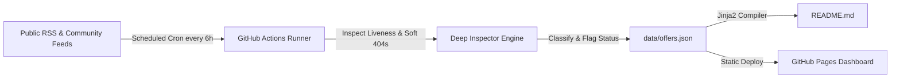

# CertPulse: Autonomous Free Cloud & Tech Certification Tracker

> **Automated, 100% free, and self-updating repository** tracking verified 100% free certification exam vouchers, accredited micro-credentials, and continuing education credits across AWS, Azure, Google Cloud, Cisco, ISC2, Oracle, Linux Foundation, Snowflake, and GitHub.

 
 
 
 

---

## Executive Summary

| Metric | Value | Definition |
| :--- | :--- | :--- |
| **Active Opportunities** | **14** | Verified 100% free exams & live registration windows |
| **Total Financial Value** | **$2,188 USD** | Aggregate savings if claimed today |
| **Last Automated Inspection** | `2026-10-14 12:50 UTC` | Auto-audited for 404s and 'Closed' notices |
| **Hosting & Compute Cost** | **$0.00 / Month** | 100% native to GitHub Actions & GitHub Pages |

---

## Verified Active Certification Offers

### Security

| Provider | Certification & Program | Type | Value (USD) | Status | Claim Link |
| :--- | :--- | :--- | :---: | :---: | :--- |
| **ISC2** | Certified in Cybersecurity (CC) | `100% Free Exam Voucher` | $199 | 🟢 Active | [**Claim Offer**](https://www.isc2.org/landing/1mcc) |
| **Qualys** | Vulnerability Management & CSAM Specialist | `100% Free Credential` | $150 | 🟢 Active | [**Claim Offer**](https://www.qualys.com/training) |
| **Fortinet** | Fortinet Certified Fundamentals (FCF) | `100% Free Credential` | $100 | 🟢 Active | [**Claim Offer**](https://www.fortinet.com/training/cybersecurity-professionals) |

### Cloud & Data

| Provider | Certification & Program | Type | Value (USD) | Status | Claim Link |
| :--- | :--- | :--- | :---: | :---: | :--- |
| **Oracle Cloud** | OCI Foundations & Associate Certifications | `100% Free Exam Voucher` | $245 | 🟢 Active | [**Claim Offer**](https://education.oracle.com/oracle-cloud-infrastructure) |

### Cloud & AI

| Provider | Certification & Program | Type | Value (USD) | Status | Claim Link |
| :--- | :--- | :--- | :---: | :---: | :--- |
| **Microsoft Azure** | Microsoft Applied Skills (Azure, AI, Power Platform) | `100% Free Credential` | $100 | 🟢 Active | [**Claim Offer**](https://learn.microsoft.com/en-us/credentials/applied-skills/) |
| **Google Cloud** | Google Cloud Skill Badges & Arcade Milestones | `Free Skill Badges & Swag` | $100 | 🟢 Active | [**Claim Offer**](https://www.cloudskillsboost.google/) |

### DevOps & Cloud Native

| Provider | Certification & Program | Type | Value (USD) | Status | Claim Link |
| :--- | :--- | :--- | :---: | :---: | :--- |
| **Linux Foundation / CNCF** | Certified Kubernetes Administrator (CKA) / LFCS | `100% Free Scholarship Voucher` | $395 | 🟢 Active | [**Claim Offer**](https://www.linuxfoundation.org/about/lift-scholarships) |

### AI & Data

| Provider | Certification & Program | Type | Value (USD) | Status | Claim Link |
| :--- | :--- | :--- | :---: | :---: | :--- |
| **Snowflake** | Snowflake Data Warehousing & Data Applications Badges | `100% Free Credential` | $150 | 🟢 Active | [**Claim Offer**](https://learn.snowflake.com/en/) |
| **MongoDB** | MongoDB Associate Developer / DBA | `Free Training & Student Voucher` | $150 | 🟢 Active | [**Claim Offer**](https://learn.mongodb.com/) |

### CRM & Cloud

| Provider | Certification & Program | Type | Value (USD) | Status | Claim Link |
| :--- | :--- | :--- | :---: | :---: | :--- |
| **Salesforce** | Salesforce Certified Administrator / App Builder | `Quest Sweepstakes Voucher` | $200 | 🟢 Active | [**Claim Offer**](https://trailhead.salesforce.com/quests) |

### API & DevOps

| Provider | Certification & Program | Type | Value (USD) | Status | Claim Link |
| :--- | :--- | :--- | :---: | :---: | :--- |
| **Postman** | Postman API Fundamentals Student / Pro Expert | `100% Free Credential` | $50 | 🟢 Active | [**Claim Offer**](https://academy.postman.com/) |

### Networking

| Provider | Certification & Program | Type | Value (USD) | Status | Claim Link |
| :--- | :--- | :--- | :---: | :---: | :--- |
| **Juniper Networks** | JNCIA-Junos / JNCIA-SEC Associate | `75%-100% Discount Voucher` | $200 | 🟢 Active | [**Claim Offer**](https://learningportal.juniper.net/juniper/user_activity_info.aspx?id=11478) |

### DevOps

| Provider | Certification & Program | Type | Value (USD) | Status | Claim Link |
| :--- | :--- | :--- | :---: | :---: | :--- |
| **GitHub** | GitHub Foundations | `Student 100% Free Voucher` | $99 | 🟢 Active | [**Claim Offer**](https://education.github.com/pack) |

### Cloud Computing

| Provider | Certification & Program | Type | Value (USD) | Status | Claim Link |
| :--- | :--- | :--- | :---: | :---: | :--- |
| **Amazon Web Services** | AWS Educate Graduate & Practitioner Badges | `Free Digital Credential` | $50 | 🟢 Active | [**Claim Offer**](https://aws.amazon.com/education/awseducate/) |

---

## Recently Closed / Expired Opportunities
> These offers were active previously but our automated inspector detected that registration has reached capacity, expired, or returned an error.

| Provider | Certification | Concluded Status | Reason / Inspection Note |
| :--- | :--- | :---: | :--- |
| **Cisco** | Cisco Continuing Education (Recertification) | Review Needed | Normal Certification Site: No active free voucher or waiver signal found |
| **Databricks** | Generative AI Fundamentals | 🟡 Closed / Waitlist | Detected closure phrase: 'no longer available' |

---

## Detailed Claiming Instructions

#### ISC2 Certified in Cybersecurity (CC) - 100% Free Exam + Education
- **Provider:** ISC2
- **Value:** $199 USD
- **Eligibility:** Global (First-time ISC2 candidates)
- **Steps to Claim:** Sign up for a free ISC2 Candidate account, complete the free self-paced CC course, and book the Pearson VUE exam with the 100% discount promo code.
- **Official Link:** [https://www.isc2.org/landing/1mcc](https://www.isc2.org/landing/1mcc)

#### Oracle Cloud Infrastructure (OCI) Free Certifications & Learning
- **Provider:** Oracle Cloud
- **Value:** $245 USD
- **Eligibility:** Global (Free Oracle University account)
- **Steps to Claim:** Enroll in Oracle University OCI learning paths. Complete the training modules to unlock free proctored online exam attempts during the promotional cycle.
- **Official Link:** [https://education.oracle.com/oracle-cloud-infrastructure](https://education.oracle.com/oracle-cloud-infrastructure)

#### Microsoft Applied Skills - 100% Free Verifiable Cloud Credentials
- **Provider:** Microsoft Azure
- **Value:** $100 USD
- **Eligibility:** Global (Free for all)
- **Steps to Claim:** Select an Applied Skills topic on Microsoft Learn, complete the 2-hour interactive cloud lab assessment, and earn a verifiable Microsoft credential badge.
- **Official Link:** [https://learn.microsoft.com/en-us/credentials/applied-skills/](https://learn.microsoft.com/en-us/credentials/applied-skills/)

#### Google Cloud Skills Boost & Innovators Free Badges
- **Provider:** Google Cloud
- **Value:** $100 USD
- **Eligibility:** Global (Google Account)
- **Steps to Claim:** Join Google Cloud Innovators to receive free monthly credits for Cloud Skills Boost, complete quest labs, and earn shareable skill credentials.
- **Official Link:** [https://www.cloudskillsboost.google/](https://www.cloudskillsboost.google/)

#### Linux Foundation LiFT Scholarships (Free CKA, CKAD, LFCS Exams)
- **Provider:** Linux Foundation / CNCF
- **Value:** $395 USD
- **Eligibility:** Global (Application-based scholarship for underrepresented & students)
- **Steps to Claim:** Submit an application during the annual LiFT scholarship window describing your career goals. Winners receive a 100% free exam voucher + training course.
- **Official Link:** [https://www.linuxfoundation.org/about/lift-scholarships](https://www.linuxfoundation.org/about/lift-scholarships)

#### Snowflake Hands-on Essentials Free Digital Badges
- **Provider:** Snowflake
- **Value:** $150 USD
- **Eligibility:** Global (Free registration)
- **Steps to Claim:** Enroll in the free Snowflake Hands-on Essentials track on Snowflake University. Complete interactive SQL lab exercises to earn verified Accredible badges.
- **Official Link:** [https://learn.snowflake.com/en/](https://learn.snowflake.com/en/)

#### MongoDB University Free Courses & Associate Exam Drives
- **Provider:** MongoDB
- **Value:** $150 USD
- **Eligibility:** Global (100% free voucher for students via GitHub Student Pack)
- **Steps to Claim:** Complete free developer learning paths on MongoDB University. Students can claim 100% free certification exam vouchers through the GitHub Student Developer Pack.
- **Official Link:** [https://learn.mongodb.com/](https://learn.mongodb.com/)

#### Salesforce Trailhead Quests - Free Certification Vouchers
- **Provider:** Salesforce
- **Value:** $200 USD
- **Eligibility:** Global (Trailhead users)
- **Steps to Claim:** Complete monthly designated Trailhead Quests or certification preparation trails to enter sweepstakes for $200 free Salesforce certification vouchers.
- **Official Link:** [https://trailhead.salesforce.com/quests](https://trailhead.salesforce.com/quests)

#### Postman API Fundamentals & Student Expert Certifications
- **Provider:** Postman
- **Value:** $50 USD
- **Eligibility:** Global (Free for all developers & students)
- **Steps to Claim:** Fork the official Postman training collection, complete the hands-on API testing requests, submit your workspace URL, and claim your verified digital badge.
- **Official Link:** [https://academy.postman.com/](https://academy.postman.com/)

#### Juniper Open Learning - JNCIA Associate Certification Vouchers
- **Provider:** Juniper Networks
- **Value:** $200 USD
- **Eligibility:** Global (Participants of Open Learning webinars)
- **Steps to Claim:** Register for a free Juniper Open Learning webinar session, complete the pre-assessment module with a passing score, and receive a Pearson VUE voucher.
- **Official Link:** [https://learningportal.juniper.net/juniper/user_activity_info.aspx?id=11478](https://learningportal.juniper.net/juniper/user_activity_info.aspx?id=11478)

#### Qualys Certified Specialist - Free Vulnerability & Compliance Certs
- **Provider:** Qualys
- **Value:** $150 USD
- **Eligibility:** Global (Free registration)
- **Steps to Claim:** Create an account on the Qualys Training portal, complete the self-paced video labs, and take the online proctored exam to earn certification.
- **Official Link:** [https://www.qualys.com/training](https://www.qualys.com/training)

#### Fortinet Certified Fundamentals (FCF) in Cybersecurity
- **Provider:** Fortinet
- **Value:** $100 USD
- **Eligibility:** Global (Fortinet Training Institute)
- **Steps to Claim:** Create a free account on the Fortinet Training Institute portal. Complete the 'Introduction to the Threat Landscape' course and pass the quiz to claim your certificate.
- **Official Link:** [https://www.fortinet.com/training/cybersecurity-professionals](https://www.fortinet.com/training/cybersecurity-professionals)

#### GitHub Foundations Certification via Student Developer Pack
- **Provider:** GitHub
- **Value:** $99 USD
- **Eligibility:** Active students verified via GitHub Student Developer Pack
- **Steps to Claim:** Verify student status on GitHub Education, claim the certification discount code from the benefits page, and register through PSI or Pearson VUE.
- **Official Link:** [https://education.github.com/pack](https://education.github.com/pack)

#### AWS Educate & Emerging Talent - Free Credentials & Practice Vouchers
- **Provider:** Amazon Web Services
- **Value:** $50 USD
- **Eligibility:** Global (No credit card required)
- **Steps to Claim:** Sign up for AWS Educate without an AWS account or credit card. Complete hands-on cloud labs to earn industry-recognized digital credentials.
- **Official Link:** [https://aws.amazon.com/education/awseducate/](https://aws.amazon.com/education/awseducate/)

---

## Architecture: How This Repo Updates Itself ($0 Cost)

1. **Zero External Servers**: Runs directly on GitHub Actions (`ubuntu-latest`).
2. **Deep Inspection Guardian**: The crawler not only checks HTTP status codes (404/500) but reads page HTML to spot 'Registrations Closed' or 'All vouchers claimed' notices.
3. **Zero Git Noise**: Only commits changes to `README.md` and `data/offers.json` when actual updates are detected.

---

## Contributing & Submitting Offers

Found a new free voucher or noticed an expired link?
- Open an issue using the [Submit Free Voucher](../../issues) template.
- Or open a quick PR editing `data/offers.json`.

---

*Built for the tech community. Audited automatically on `2026-10-14 12:50 UTC`.*