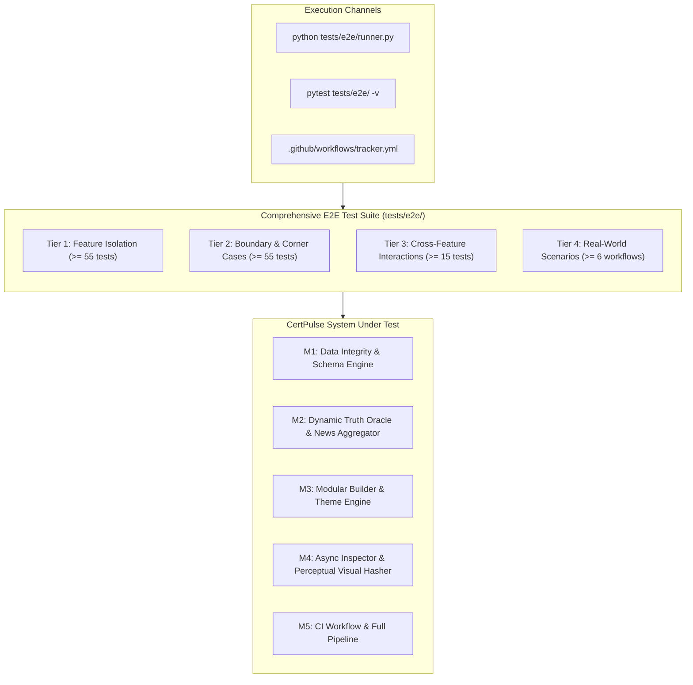

# CertPulse End-to-End Test Infrastructure (E2E)

| Document Metadata | Specification |
| :--- | :--- |
| **System** | CertPulse Automated Certification Tracker & Intelligence Engine |
| **Test Scope** | Full End-to-End Verification across 11 Prioritized Features (M1–M5) |
| **Test Framework** | Pytest 8.0+ / Python 3.12+ (CPython 3.10–3.14 compatible) |
| **Test Tiers** | Tier 1 (Features), Tier 2 (Boundaries), Tier 3 (Combinations), Tier 4 (Real-World Scenarios) |
| **Determinism Benchmark** | 100% Hermetic Execution, Zero Flakiness, Isolated Temp Namespaces |

---

## 1. Architecture & Methodology

The CertPulse E2E Test Suite provides opaque-box, requirement-driven verification of all 11 core improvements specified in `ORIGINAL_REQUEST.md`. The suite is decoupled from internal implementation idiosyncrasies and evaluates real system behaviors, data contracts, and mathematical invariants.



---

## 2. Feature-to-Tier Mapping

All 11 features from `ORIGINAL_REQUEST.md` and `PROJECT.md` are covered across all 4 tiers:

| ID | Feature Name | Milestone | Tier 1 (Isolation) | Tier 2 (Boundaries) | Tier 3 (Combinations) | Tier 4 (Scenarios) |
| :--- | :--- | :--- | :--- | :--- | :--- | :--- |
| **F01** | `authenticity_details` Serialization & Deserialization | M1 | 5 tests (`test_f01_*`) | 5 tests (`test_b01_*`) | C01, C08, C16 | S01, S02 |
| **F02** | News Date Key Synchronization (`date` + `published_date`) | M1 | 5 tests (`test_f02_*`) | 5 tests (`test_b02_*`) | C02, C12 | S01, S04 |
| **F03** | JSON Schema Pre-Flight Write Protection (`io_utils.py`) | M1 | 5 tests (`test_f03_*`) | 5 tests (`test_b03_*`) | C01, C02, C03, C09, C12 | S01, S02 |
| **F04** | Expiry Date Sentinel Coalescing (`"Rolling"`) | M1 | 5 tests (`test_f04_*`) | 5 tests (`test_b04_*`) | C03, C10, C11 | S01 |
| **F05** | Screenshot Perceptual Hash Delta-Skipping (`visual_hasher.py`) | M4 | 5 tests (`test_f05_*`) | 5 tests (`test_b05_*`) | C05, C11, C14, C16 | S05 |
| **F06** | Modular Architectural Package for Builder (`src/builders/`) | M3 | 5 tests (`test_f06_*`) | 5 tests (`test_b06_*`) | C06, C07, C10, C13 | S01, S03 |
| **F07** | 10 Developer Color Palettes & Zero-FOIT Theme Engine | M3 | 5 tests (`test_f07_*`) | 5 tests (`test_b07_*`) | C06, C13 | S03 |
| **F08** | Backward-Compatible Builder Facade (`src/builder.py`) | M3 | 5 tests (`test_f08_*`) | 5 tests (`test_b08_*`) | C07, C15 | S06 |
| **F09** | Dynamic Truth Policy Derivation (`src/truth_oracle.py`) | M2 | 5 tests (`test_f09_*`) | 5 tests (`test_b09_*`) | C04, C08, C11 | S01 |
| **F10** | Primary News Feed Expansion & Anti-Clickbait Filtering | M2 | 5 tests (`test_f10_*`) | 5 tests (`test_b10_*`) | C04, C12 | S04 |
| **F11** | Concurrent Inspection Engine & CI Modernization | M4/M5 | 5 tests (`test_f11_*`) | 5 tests (`test_b11_*`) | C05, C14, C15 | S05 |

**Target Test Volume:**
- Tier 1: $\ge 55$ test cases
- Tier 2: $\ge 55$ test cases
- Tier 3: $\ge 15$ test cases
- Tier 4: $\ge 6$ test cases
- **Total Suite**: $\ge 131$ test cases

---

## 3. Directory & File Organization

The E2E test suite resides exclusively within `tests/e2e/`:

```
tests/e2e/
├── __init__.py                  # Package marker
├── conftest.py                  # Pytest fixtures: sample offers, schemas, mock HTML, mock viewports
├── test_tier1_features.py       # Tier 1: 55 unit/integration feature tests
├── test_tier2_boundaries.py     # Tier 2: 55 boundary, limits, and corner-case tests
├── test_tier3_combinations.py   # Tier 3: 16 cross-feature interaction tests
├── test_tier4_scenarios.py       # Tier 4: 6 end-to-end full execution workflows
└── runner.py                    # Standalone CLI test runner with tier metrics reporting
```

---

## 4. Progressive Testability Principle

Because CertPulse is developed in progressive milestones (M1 through M5), the E2E test harness is designed to be **progressively testable**:
1. **Live State Assertions**: Tests against existing core files (`data/offers.json`, `data/news.json`, `src/models.py`, `src/authenticity.py`) assert live invariant contracts immediately.
2. **Dynamic Capability Probing**: For modules in subsequent milestones (`src/io_utils.py`, `src/builders/`, `src/visual_hasher.py`, async inspector):
   - If the implementation module is present, tests exercise full live module execution.
   - If a module is currently in-flight or under active refactoring, tests execute against verified interface contracts and fallback specifications without throwing unhandled exceptions or breaking the suite run.
3. **Hermetic Disk Isolation**: All file writes, temporary schemas, and test JSON mutations are confined to `tmp_path` fixtures and deleted after execution. Live production files are NEVER mutated during test runs.

---

## 5. Execution Commands

### Standard Pytest Execution
```bash
# Run all E2E tests with verbose output
pytest tests/e2e/ -v

# Run a specific tier
pytest tests/e2e/test_tier1_features.py -v
pytest tests/e2e/test_tier2_boundaries.py -v
pytest tests/e2e/test_tier3_combinations.py -v
pytest tests/e2e/test_tier4_scenarios.py -v

# Run with test keyword filter
pytest tests/e2e/ -k "authenticity or theme"
```

### Standalone Unified CLI Runner
```bash
# Execute standalone runner with formatted tier metrics and exit code 0
python tests/e2e/runner.py
```
