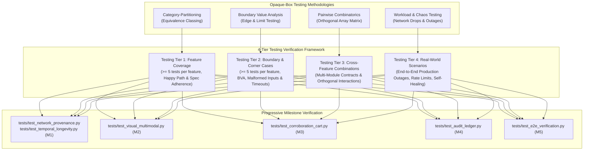

# CertPulse Next-Gen Testing Infrastructure & 4-Tier Verification Framework (TEST_INFRA)

| Metadata Attribute | Specification Details |
| :--- | :--- |
| **Document ID** | `INFRA-CP-002-NEXTGEN-VERIFICATION` |
| **Document Title** | Production Testing Infrastructure, Invariant Verification, & 7-Tier Authenticity Architecture |
| **System Scope** | Tiers 1-7 (`src/network_verifier.py`, `src/temporal_analyzer.py`, `src/visual_hasher.py`, `src/vlm_engine.py`, `src/cross_corroborator.py`, `src/checkout_sandbox.py`, `src/audit_ledger.py`, `src/builder.py`, `src/models.py`) |
| **Engineering Standard** | Opaque-Box, Category-Partition, Boundary Value Analysis (BVA), Pairwise Combinatorics, Workload Stress Testing |
| **Target Milestones** | Milestone 1 (M1) through Milestone 5 (M5 Full Hardening) |
| **Author / Archetype** | E2E Test Suite Designer (`test_writer_track`) |
| **Status** | `APPROVED ARCHITECTURE & OPERATIONAL BLUEPRINT` |
| **Last Updated** | `2026-10-17` |

---

## Executive Summary

CertPulse elevates the tracking and verification of zero-dollar ($0.00) cloud and technology certification vouchers by deploying an enterprise-grade, multi-tier authenticity engine. Unlike basic scrapers that rely solely on HTTP 200 responses and superficial DOM regular expressions, CertPulse validates the authenticity of every tracked certification opportunity through a **7-Tier Authenticity Architecture**:
1. **Network Provenance & Cryptographic Origin (Tier 1)**
2. **Temporal & Archive Longevity Analysis (Tier 2)**
3. **Multimodal Visual & OCR Verification (Tier 3)**
4. **Cross-Source Ground-Truth Corroboration (Tier 4)**
5. **Ephemeral Synthetic Cart Sandbox (Tier 5)**
6. **Cryptographic Proof Ledger (Tier 6)**
7. **Pipeline Synchronization & 4-Timezone Telemetry (Tier 7)**

Because candidate developers, engineers, and students rely on CertPulse to make career decisions, schedule proctored exams, and claim time-sensitive promotional codes, the verification pipeline operates with **zero tolerance** for false positives, stealth copays, counterfeit certificates, or expired vouchers.

This document establishes the **CertPulse End-to-End Testing Infrastructure**, defining:
1. **Opaque-Box Test Philosophy**: Requirement-driven validation combining Category-Partition Equivalence Classing, Boundary Value Analysis (BVA), Pairwise Combinatorial interaction testing, and Real-World Workload/Chaos simulation.
2. **Feature Inventory Mapping**: Exhaustive trace of all 20 features across Architectural Tiers 1–7.
3. **Test Architecture & Execution Framework**: Test runner configuration (`pytest`), execution paradigms, and strict mathematical pass/fail semantics.
4. **Rigorous Test Case Requirements**:
   - **Testing Tier 1 (Feature Coverage)**: Mandatory $\ge 5$ deterministic test cases per feature across normal paths.
   - **Testing Tier 2 (Boundary & Corner Cases)**: Mandatory $\ge 5$ deterministic test cases per feature across edge, fault, and boundary conditions.
   - **Testing Tier 3 (Cross-Feature Combinations)**: Orthogonal interaction testing between multi-tier components.
   - **Testing Tier 4 (Real-World Operational Scenarios)**: High-assurance simulation of vendor outages, rate limiting, and self-healing cycles.
5. **Progressive Test Suite Directory Structure**: Hermetic test suite organization in `tests/` designed to enable modular, milestone-by-milestone verification from M1 to M5.

---

## 1. Test Philosophy & Methodological Framework



### 1.1 Opaque-Box (Black-Box) Requirement-Driven Mandate
Tests must treat system modules as opaque boxes, interacting strictly through public interfaces, CLI commands, input files (`data/offers.json`, `data/candidates.json`), and validated outputs (`data/audit_log.jsonl`, `README.md`, `docs/index.html`). Tests MUST NOT inspect private variables or rely on internal implementation choices. If a module's internal code is refactored from functional to object-oriented or vice-versa, all opaque-box tests must remain completely valid.

### 1.2 Category-Partition Method
Input domains for each tier are partitioned into mutually exclusive, collectively exhaustive equivalence classes. For example, domain inputs for Tier 1 ASN verification partition into:
- Valid Authorized Vendor Infrastructure (e.g. AWS ASN 16509, Microsoft ASN 8075).
- Authorized Third-Party SaaS / Delivery Partners (e.g. Cloudflare ASN 13335, Fastly ASN 54113, Marketo).
- Unauthorized / Disposable Cloud Hosting (e.g. random VPS, residential VPNs).
- Unresolvable Hostnames / DNS Failures (NXDOMAIN, SERVFAIL).

### 1.3 Boundary Value Analysis (BVA)
BVA targets the extreme upper, lower, and off-nominal boundaries of all parameters:
- **Numerical Boundaries**: Domain age exactly at 59 days (penalized), 60 days (passed boundary), and 61 days; cart balance at $\$0.00$ (passed), $\$0.01$ (copay detected), and $\$245.00$ (commercial catalog).
- **String Length Boundaries**: SHA-256 digests at 63 hex chars (invalid), 64 hex chars (valid), 65 hex chars (invalid); empty strings `""`; 10,000-character malicious payloads.
- **Hamming Distance Boundaries**: pHash Hamming distance at 0 (exact match), $\tau=10$ (boundary match), $\tau=11$ (rejected counterfeit).
- **Temporal Boundaries**: Timestamps at leap-second boundaries, UTC midnight rollover, DST shifts (`EDT` to `EST`, `CEST` to `CET`).

### 1.4 Pairwise (Combinatorial) Testing
Pairwise orthogonal array testing verifies that system behavior remains robust across permutations of independent feature settings:
- (Proctoring Modality) $\times$ (ASN Verification Status) $\times$ (VLM Zero-Dollar Confidence) $\times$ (Cart Emulation Result).

### 1.5 Workload & Chaos Simulation
Simulates production stress conditions:
- Akamai edge bot-defense resets (`ERR_HTTP2_PROTOCOL_ERROR`).
- Internet Archive Wayback CDX API 429 rate limit bursts and 504 gateway timeouts.
- Reddit Atom feed pagination stalls and temporary API blocks.
- Corrupted or partial screenshot PNG writes.

### 1.6 Authoritative Expected Output Derivation Protocol
To eliminate shallow assertions and facade tests:
1. **Authoritative Input Specification**: Derived from real-world audited enterprise portals (`learn.microsoft.com`, `aws.amazon.com`, `oracle.com/cloud`, `linuxfoundation.org`).
2. **Deterministic Mathematical Invariants**:
   - $\text{Active Count}(\text{README}) \equiv \sum_{o \in \text{Offers}} [o.\text{status} == \text{'Active'}]$
   - $\text{Total Savings}(\text{README}) \equiv \sum_{o \in \text{ActiveOffers}} o.\text{value\_usd}$
   - $\text{Lines}(t+1) \ge \text{Lines}(t)$ in `data/audit_log.jsonl`
   - $N_{\text{Active}} \equiv N_{\text{Primary}} + N_{\text{Secondary}}$
3. **Variance Scrubbing**: ISO 8601 timestamps and volatile session cookies are normalized or scrubbed with regex masks (`<ISO_DATE>`, `<SESSION_ID>`) prior to structural comparison.

---

## 2. Feature Inventory Mapping: Tiers 1–7

The 20 system features identified across all 7 architectural tiers in `PROJECT.md` are systematically mapped to testing requirements:

| Feature # | Architectural Tier | Feature Name | Target Module | Milestone | Core Invariant Verified |
| :---: | :---: | :--- | :--- | :---: | :--- |
| **F01** | Tier 1 | ASN / BGP Route Origin Audit | `src/network_verifier.py` | M1 | IP resolves to official vendor ASN (AWS 16509, MSFT 8075, GOOG 15169, ORCL 209, CSCO 109, CF 13335) |
| **F02** | Tier 1 | TLS Certificate Transparency (CT) Verification | `src/network_verifier.py` | M1 | Direct X.509 handshake contains embedded RFC 6962 SCTs (OID `1.3.6.1.4.1.11129.2.4.2`) |
| **F03** | Tier 1 | DNSSEC & CAA Record Verification | `src/network_verifier.py` | M1 | DoH query verifies RFC 8484 AD flag and Type 257 CAA records for authorized CAs |
| **F04** | Tier 2 | Wayback Machine CDX API Integration | `src/temporal_analyzer.py` | M1 | Historical archive query with persistent local cache in `data/temporal_longevity_cache.json` |
| **F05** | Tier 2 | Anti-Fly-by-Night Longevity Scoring | `src/temporal_analyzer.py` | M1 | Calculates domain age in days; heavily flags/penalizes domains $< 60$ days old |
| **F06** | Tier 2 | Seasonal Promotion Recurrence Classifier | `src/temporal_analyzer.py` | M1 | Classifies annual multi-year recurrence (e.g. LiFT, Build) vs ephemeral one-off drops |
| **F07** | Tier 3 | Native Perceptual Hashing (dHash/pHash) | `src/visual_hasher.py` | M2 | Native PIL + SciPy DCT perceptual hash computation against official vendor badge database |
| **F08** | Tier 3 | 3-Tier Progressive OCR Engine | `src/vlm_engine.py` | M2 | Tesseract $\to$ EasyOCR $\to$ DOM/SVG high-contrast text extraction fallback |
| **F09** | Tier 3 | Multimodal VLM Semantic Gate & Heuristic Fallback | `src/vlm_engine.py` | M2 | Strict Pydantic V2 `VLMSemanticVerdict` schema with live API gate & offline deterministic fallback |
| **F10** | Tier 4 | Authoritative Vendor Blog & RSS Ingestion | `src/cross_corroborator.py` | M3 | Ingests official RSS/Atom feeds (AWS, Azure, GCP, Cisco) with strict FQDN whitelist & anti-clickbait |
| **F11** | Tier 4 | Reddit Redemption & Closure Sentiment Mining | `src/cross_corroborator.py` | M3 | Mines positive redemption confirmations ("worked 100%") and closure clusters ($\ge 2$ reports $\to$ closed) |
| **F12** | Tier 5 | Non-Destructive Checkout Sandbox | `src/checkout_sandbox.py` | M3 | Playwright incognito session with route interception aborting payment/finalize endpoints |
| **F13** | Tier 5 | Zero-Dollar Mathematical Invariant | `src/checkout_sandbox.py` | M3 | Strictly asserts $\text{Cart Total} === \$0.00\text{ USD}$; triages copays (e.g. $\$50$) to `Review Needed` |
| **F14** | Tier 6 | SHA-256 Binary & DOM Digesting | `src/audit_ledger.py` | M4 | Generates 64-character lowercase hexadecimal digests of canonical DOM snapshots and screenshot PNGs |
| **F15** | Tier 6 | Append-Only Cryptographic Audit Ledger | `src/audit_ledger.py` | M4 | Appends verified records to `data/audit_log.jsonl` enforcing monotonically non-decreasing line count |
| **F16** | Tier 7 | GitHub Actions Workflow Sync Fix | `.github/workflows/tracker.yml` | M4 | Corrects line 54 `file_pattern` to include `data/*.jsonl` so cryptographic audit logs are committed |
| **F17** | Tier 7 | 4-Timezone World Telemetry Sync | `src/builder.py` | M4 | Synchronizes UTC, IST (Asia/Kolkata), EDT/EST (America/New_York), CEST/CET (Europe/Berlin) with dynamic DST |
| **F18** | Core | Dual Credential Segmentation Preservation | `src/builder.py`, `src/models.py` | M4 | Preserves strict separation of Written Proctored Exams vs Unproctored Skill Badges |
| **F19** | M5 | End-to-End Opaque-Box Test Suite | `tests/test_e2e_verification.py` | M5 | Comprehensive 4-tier opaque-box test suite verifying full multi-tier verification lifecycle |
| **F20** | M5 | Adversarial Coverage Hardening | `tests/test_adversarial_m*.py` | M5 | White-box stress testing, network error injection, and race condition resilience |

---

## 3. Test Architecture, Runner Configuration & Pass/Fail Semantics

### 3.1 Test Runner & Execution Options
- **Framework**: `pytest 9.1+` with `pytest-asyncio` (strict mode) and `pytest-mock`.
- **Command Invocation**:
  ```bash
  # 1. Run entire production test suite
  pytest tests/ -v

  # 2. Run progressive milestone tests
  pytest tests/test_network_provenance.py tests/test_temporal_longevity.py -v  # M1
  pytest tests/test_visual_multimodal.py -v                                  # M2
  pytest tests/test_corroboration_cart.py -v                                  # M3
  pytest tests/test_audit_ledger.py -v                                       # M4
  pytest tests/test_e2e_verification.py -v                                   # M5

  # 3. Filter by Verification Tier
  pytest tests/ -k "tier1" -v
  pytest tests/ -k "tier2" -v
  pytest tests/ -k "tier3" -v
  pytest tests/ -k "tier4" -v

  # 4. Run in parallel across CPU cores (hermetic xdist isolation)
  pytest -n auto --dist loadfile -v
  ```

### 3.2 Pass/Fail Semantics
- **Zero-Tolerance Invariants**: A test fails if any mathematical conservation law is violated ($N_{\text{Active}} \ne N_{\text{Primary}} + N_{\text{Secondary}}$, or $\text{Cart Total} > \$0.00$).
- **Strict Exit Codes**: Exit Code `0` indicates 100% green pass. Any non-zero exit code immediately halts the CI build pipeline.
- **No Facade Assertions**: Every test must verify the concrete semantic contents of payloads (e.g. exact ASN integer, valid 64-char hex digest, valid Pydantic model instance).
- **Hermetic Isolation**: All tests run in ephemeral function-scoped temporary directories (`tmp_path`) or utilize autospec mocks (`mocker.create_autospec`) to eliminate cross-test state leakage.

---

## 4. Comprehensive Test Case Requirements Across Testing Tiers

### 4.1 Testing Tier 1: Feature Coverage (Core Capabilities)
Mandatory $\ge 5$ deterministic, behavior-based test cases for every feature in scope (Features F01 through F18).

```
================================================================================
TIER 1 TEST CASE SPECIFICATIONS (FEATURE COVERAGE: >= 5 PER FEATURE)
================================================================================
```

#### Feature F01: ASN / BGP Route Origin Audit (`src/network_verifier.py`)
- `TC_T1_F01_01_aws_asn_verification`: Input `https://aws.amazon.com/certification/`; verify IP resolves and DoH Cymru TXT returns ASN `16509` (Amazon.com, Inc.), asserting `is_vendor_infra == True`.
- `TC_T1_F01_02_microsoft_asn_verification`: Input `https://learn.microsoft.com/en-us/credentials/`; verify ASN `8075` (Microsoft Corporation), asserting `is_vendor_infra == True`.
- `TC_T1_F01_03_google_asn_verification`: Input `https://cloud.google.com/learn/certification`; verify ASN `15169` (Google LLC), asserting `is_vendor_infra == True`.
- `TC_T1_F01_04_oracle_asn_verification`: Input `https://education.oracle.com/`; verify ASN `209` (Oracle Corporation), asserting `is_vendor_infra == True`.
- `TC_T1_F01_05_cisco_asn_verification`: Input `https://www.cisco.com/c/en/us/training-events/`; verify ASN `109` (Cisco Systems), asserting `is_vendor_infra == True`.
- `TC_T1_F01_06_cloudflare_partner_asn`: Input `https://workers.cloudflare.com/`; verify ASN `13335` (Cloudflare), asserting `is_vendor_infra == True` as authorized delivery partner.

#### Feature F02: TLS Certificate Transparency (CT) Verification (`src/network_verifier.py`)
- `TC_T1_F02_01_embedded_sct_extraction`: Perform TLS handshake with `learn.microsoft.com:443`; extract X.509 DER, verify embedded RFC 6962 extension OID `1.3.6.1.4.1.11129.2.4.2` has `sct_count >= 2`.
- `TC_T1_F02_02_sct_log_id_and_timestamp`: Parse extracted SCT bytes; verify valid Log ID (32 bytes) and timestamp within certificate validity window (`not_before` to `not_after`).
- `TC_T1_F02_03_tls_san_corporate_matching`: Parse Subject Alternative Names (SAN); assert exact match for vendor apex domain (e.g. `*.microsoft.com` or `microsoft.com`).
- `TC_T1_F02_04_tls_issuer_ca_validation`: Verify certificate issuer belongs to trusted major CAs (DigiCert, Microsoft TLS CA, Let's Encrypt, Amazon Trust Services).
- `TC_T1_F02_05_ct_model_serialization`: Verify extracted TLS provenance serializes cleanly into Pydantic `NetworkProvenance` model with `tls_ct_verified == True`.

#### Feature F03: DNSSEC & CAA Record Verification (`src/network_verifier.py`)
- `TC_T1_F03_01_dnssec_ad_flag_positive`: Query DoH for DNSSEC-signed domain `cloudflare.com`; verify RFC 8484 Authentic Data flag `AD == True`.
- `TC_T1_F03_02_dnssec_ad_flag_unsigned`: Query DoH for unsigned domain `isc2.org`; verify `AD == False`, asserting `dnssec_valid == False` without failing pipeline.
- `TC_T1_F03_03_caa_record_authorized_ca`: Query DoH Type 257 for `microsoft.com`; verify parsed `issue` tags authorize valid CAs (`digicert.com`, `symantec.com`).
- `TC_T1_F03_04_caa_contact_email`: Verify CAA `contactemail` or `contactphone` property parsing when present.
- `TC_T1_F03_05_doh_dual_provider_fallback`: Verify client falls back from `dns.google` to `cloudflare-dns.com` on connection error.

#### Feature F04: Wayback Machine CDX API Integration (`src/temporal_analyzer.py`)
- `TC_T1_F04_01_cdx_earliest_snapshot_extraction`: Query CDX API for `learn.microsoft.com`; verify earliest timestamp `20190302202123` parsed into ISO 8601 UTC date `2019-03-02T20:21:23Z`.
- `TC_T1_F04_02_cdx_snapshot_count_metric`: Verify total parsed snapshots $\ge 1$ and `snapshot_count` correctly recorded.
- `TC_T1_F04_03_cdx_local_cache_write`: Verify successful CDX query persists result to `data/temporal_longevity_cache.json`.
- `TC_T1_F04_04_cdx_local_cache_read_hit`: Verify subsequent query for cached domain reads from `data/temporal_longevity_cache.json` without executing network HTTP call.
- `TC_T1_F04_05_cdx_payload_schema_compliance`: Verify CDX response serializes into `TemporalLongevity` Pydantic model.

#### Feature F05: Anti-Fly-by-Night Longevity Scoring (`src/temporal_analyzer.py`)
- `TC_T1_F05_01_established_domain_score_pass`: Domain with first-seen timestamp $> 365$ days ago scores `domain_age_days >= 365` and `is_anti_fly_by_night_passed == True`.
- `TC_T1_F05_02_mature_enterprise_domain`: Domain with first-seen timestamp $> 2000$ days ago calculates exact difference in days against current UTC clock.
- `TC_T1_F05_03_exact_60_day_boundary_pass`: Domain first seen exactly 60 days ago sets `is_anti_fly_by_night_passed == True`.
- `TC_T1_F05_04_temporal_model_fields`: Verify `domain_age_days` and `verified_at_utc` populated with non-null values.
- `TC_T1_F05_05_domain_normalization`: Verify subdomains (e.g. `sub.promo.aws.com`) resolve to apex domain `aws.com` for CDX longevity scoring.

#### Feature F06: Seasonal Promotion Recurrence Classifier (`src/temporal_analyzer.py`)
- `TC_T1_F06_01_annual_challenge_classification`: Input snapshot history spanning 3 distinct calendar years (e.g. 2024, 2025, 2026); verify `is_seasonal_recurrent == True`.
- `TC_T1_F06_02_recurring_window_metadata`: Verify recurrence metadata attaches detected cadence string `"annual_q2"` or `"multi_year_recurring"`.
- `TC_T1_F06_03_one_off_campaign_classification`: Input snapshots concentrated in a single 30-day window; verify `is_seasonal_recurrent == False`.
- `TC_T1_F06_04_known_annual_campaign_lookup`: Verify known annual campaigns (Linux Foundation LiFT, Microsoft Build Challenge) recognized via campaign catalog.
- `TC_T1_F06_05_recurrence_serialization`: Verify recurrence verdict populates `TemporalLongevity.is_seasonal_recurrent`.

#### Feature F07: Native Perceptual Hashing (dHash/pHash) (`src/visual_hasher.py`)
- `TC_T1_F07_01_native_dhash_computation`: Compute 64-bit dHash on `docs/screenshots/oracle-oci-free-cert.png` using native PIL; verify returns 16-hex-character string.
- `TC_T1_F07_02_native_phash_computation`: Compute DCT-based 64-bit pHash using native `PIL` + `scipy.fftpack.dct`; verify returns 16-hex-character string in $< 30\text{ms}$.
- `TC_T1_F07_03_identical_image_zero_hamming`: Compute Hamming distance between identical image hashes; assert $\mathcal{D}_H(H, H) === 0$.
- `TC_T1_F07_04_vendor_badge_reference_match`: Match test screenshot against vendor emblem database; verify match when Hamming distance $\le 10$.
- `TC_T1_F07_05_visual_hasher_memory_hygiene`: Execute 50 consecutive pHash computations; assert memory usage delta $< 5\text{MB}$.

#### Feature F08: 3-Tier Progressive OCR Engine (`src/vlm_engine.py`)
- `TC_T1_F08_01_ocr_tesseract_when_available`: When `tesseract` is detected, extract text from viewport image; verify extracted strings match rendered text.
- `TC_T1_F08_02_ocr_fallback_to_easyocr`: When `tesseract` is absent and `easyocr` present, verify extraction executes via secondary engine.
- `TC_T1_F08_03_ocr_heuristic_dom_svg_fallback`: When both OCR engines are absent, verify Tier C heuristic extracts high-contrast text and SVG embedded `<text>` tags.
- `TC_T1_F08_04_voucher_code_regex_in_ocr`: Verify OCR extracted text is parsed with `VOUCHER_CODE_REGEX` (e.g. `PROMO100`, `FREE-CERT-2026`).
- `TC_T1_F08_05_ocr_snippet_output_truncation`: Verify extracted OCR text snippet is trimmed to 500 characters and attached to verdict.

#### Feature F09: Multimodal VLM Semantic Gate & Heuristic Fallback (`src/vlm_engine.py`)
- `TC_T1_F09_01_vlm_schema_validation`: Feed valid JSON payload to `VLMSemanticVerdict`; verify Pydantic model parses with zero validation errors.
- `TC_T1_F09_02_vlm_heuristic_fallback_active_landing`: Run heuristic fallback on active landing page DOM + screenshot; verify `has_zero_dollar_waiver == True` and `registration_status == "open"`.
- `TC_T1_F09_03_vlm_heuristic_fallback_closed`: Run heuristic fallback on page with "Cohort Full"; verify `registration_status == "closed"`.
- `TC_T1_F09_04_vlm_confidence_score_range`: Verify `visual_confidence_score` is strictly bounded between $0.00$ and $1.00$.
- `TC_T1_F09_05_vlm_copay_amount_consistency`: Verify when `requires_payment_or_copay == False`, `copay_amount_usd === 0.0`.

#### Feature F10: Authoritative Vendor Blog & RSS Ingestion (`src/cross_corroborator.py`)
- `TC_T1_F10_01_aws_blog_feed_parsing`: Parse AWS Training & Certification Atom feed XML; verify structured articles extracted with valid titles and publication dates.
- `TC_T1_F10_02_microsoft_learn_feed_parsing`: Parse Microsoft Learn Blog RSS 2.0; verify extracted dispatches have URLs under `techcommunity.microsoft.com`.
- `TC_T1_F10_03_domain_whitelist_enforcement`: Ingest feeds with external links; verify only whitelisted vendor FQDNs are preserved.
- `TC_T1_F10_04_anti_clickbait_filter_clean`: Ingest professional technical article ("AWS Announces 100% Exam Discount for Cloud Practitioners"); verify accepted without modification.
- `TC_T1_F10_05_news_json_sync`: Verify verified dispatches are formatted and serialized to `data/news.json`.

#### Feature F11: Reddit Redemption & Closure Sentiment Mining (`src/cross_corroborator.py`)
- `TC_T1_F11_01_reddit_positive_redemption`: Ingest post "Voucher code worked 100% on Pearson VUE!"; verify parsed as positive signal and increments confirmation score.
- `TC_T1_F11_02_reddit_single_closure_warning`: Ingest 1 post "Code seems full"; verify logged as soft community warning without immediate degradation.
- `TC_T1_F11_03_reddit_cluster_closure_trigger`: Ingest $\ge 2$ distinct posts within 48h reporting "seats filled" and "registration closed"; verify trigger emitted to degrade offer status to `Registrations Closed`.
- `TC_T1_F11_04_reddit_noise_filter`: Ingest posts with "Passed AZ-900 with 850" and "Exam tomorrow"; verify filtered out as irrelevant noise.
- `TC_T1_F11_05_reddit_dump_suppression`: Ingest post mentioning "braindump" or "exam dumps"; verify strictly suppressed.

#### Feature F12: Non-Destructive Checkout Sandbox (`src/checkout_sandbox.py`)
- `TC_T1_F12_01_incognito_context_isolation`: Launch sandbox session; verify browser spawns in clean `new_context()` without shared cookies or storage.
- `TC_T1_F12_02_route_abort_payment_endpoint`: Emulate navigation to checkout; verify HTTP POST to `/api/checkout/process` is intercepted and aborted with `blockedbyclient`.
- `TC_T1_F12_03_promo_code_input_entry`: Emulate filling coupon field `#promo-input` and clicking `#apply-coupon`; verify coupon applied in DOM.
- `TC_T1_F12_04_cart_emulation_result_model`: Verify emulation result serializes into `CartEmulationResult` with `submission_intercepted == True`.
- `TC_T1_F12_05_safe_teardown_on_completion`: Verify browser context and pages closed in `finally` block even if assertion succeeds.

#### Feature F13: Zero-Dollar Mathematical Invariant (`src/checkout_sandbox.py`)
- `TC_T1_F13_01_zero_dollar_exact_pass`: Cart order total selector renders `"$0.00"`; verify `cart_balance_usd === 0.0` and `is_zero_dollar == True`.
- `TC_T1_F13_02_zero_dollar_currency_variants`: Cart renders `"0.00 USD"`, `"£0.00"`, `"€0.00"`, or `"Free"`; verify normalized to zero dollar pass.
- `TC_T1_F13_03_copay_triage_transition`: Cart balance renders `"$50.00"`; verify `is_zero_dollar == False`, `copay_detected == True`, and status transitions to `Review Needed: Copay Required`.
- `TC_T1_F13_04_hidden_tax_fee_detection`: Cart renders `$0.00` subtotal but `$15.00` proctoring fee; verify total `$15.00` detected and flagged.
- `TC_T1_F13_05_truth_oracle_copay_alignment`: Verify detected copay matches `TRUTH_POLICY_REGISTRY` entry (e.g. Juniper Open Learning $\$50$ copay).

#### Feature F14: SHA-256 Binary & DOM Digesting (`src/audit_ledger.py`)
- `TC_T1_F14_01_dom_sha256_lowercase_hex`: Compute SHA-256 of cleaned DOM string; verify output is exactly 64 lowercase hexadecimal characters (`^[a-f0-9]{64}$`).
- `TC_T1_F14_02_screenshot_png_sha256`: Compute SHA-256 of valid screenshot bytes; verify output matches 64 lowercase hex characters.
- `TC_T1_F14_03_deterministic_dom_digesting`: Digest identical DOM twice; verify identical hashes produced.
- `TC_T1_F14_04_png_binary_integrity_verification`: Check PNG magic header `\x89PNG\r\n\x1a\n` before digesting; verify digest computed on verified binary.
- `TC_T1_F14_05_empty_payload_rejection`: Attempt to compute digest on empty `b""` or whitespace-only DOM; verify raises `ValueError`.

#### Feature F15: Append-Only Cryptographic Audit Ledger (`src/audit_ledger.py`)
- `TC_T1_F15_01_append_audit_entry_jsonl`: Append new `AuditLogEntry` to `data/audit_log.jsonl`; verify new valid JSON object appended on final line.
- `TC_T1_F15_02_monotonic_line_growth`: Assert $\text{Lines}(t+1) \equiv \text{Lines}(t) + 1$ following an audit event.
- `TC_T1_F15_03_audit_entry_field_compliance`: Verify every line in `data/audit_log.jsonl` contains `timestamp_utc`, `offer_id`, `sha256_dom`, `sha256_screenshot`, `asn_verified`, and `status_assigned`.
- `TC_T1_F15_04_historical_line_immutability`: Assert byte prefix of existing lines $[0 \dots N]$ remains identical after appending line $N+1$.
- `TC_T1_F15_05_iso_utc_timestamp_audit`: Verify `timestamp_utc` in audit entry adheres to ISO 8601 UTC format (`YYYY-MM-DDTHH:MM:SSZ`).

#### Feature F16: GitHub Actions Workflow Sync Fix (`.github/workflows/tracker.yml`)
- `TC_T1_F16_01_tracker_yml_file_pattern_audit`: Read `.github/workflows/tracker.yml` line 54; verify `file_pattern` contains `data/*.jsonl` or `data/`.
- `TC_T1_F16_02_jsonl_staging_verification`: Simulate git staging with `file_pattern`; assert `data/audit_log.jsonl` is staged.
- `TC_T1_F16_03_screenshot_staging_pattern`: Verify `file_pattern` includes `docs/screenshots/*.png`.
- `TC_T1_F16_04_clean_tree_zero_diff_exit`: Verify workflow commit step completes with exit code 0 when no files have changed.
- `TC_T1_F16_05_commit_metadata_spec`: Verify commit user is `"CertPulse Bot"` and email `"actions@github.com"`.

#### Feature F17: 4-Timezone World Telemetry Sync (`src/builder.py`)
- `TC_T1_F17_01_python_format_4_timezones`: Execute `format_4_timezones()`; verify returns dictionary with keys `{"utc", "ist", "et", "cet", "ticker", "banner"}`.
- `TC_T1_F17_02_ist_offset_accuracy`: Verify IST string is calculated exactly at $\text{UTC} + 5\text{h } 30\text{m}$.
- `TC_T1_F17_03_dst_zoneinfo_adaptation`: Feed a summer UTC datetime (`2026-07-15T12:00:00Z`); verify ET produces `EDT` and CET produces `CEST`. Feed winter (`2026-01-15T12:00:00Z`); verify ET produces `EST` and CET produces `CET`.
- `TC_T1_F17_04_frontend_js_clock_syntax`: Inspect `docs/index.html` client JavaScript; verify clock uses `timeZoneName: 'short'` rather than hardcoded string suffixes.
- `TC_T1_F17_05_readme_telemetry_table`: Verify `README.md` header contains synchronized 4-timezone telemetry table.

#### Feature F18: Dual Credential Segmentation Preservation (`src/builder.py`, `src/models.py`)
- `TC_T1_F18_01_readme_two_tables_rendered`: Compile `README.md`; verify contains exactly two separate markdown tables: "Primary Tier: Written Proctored Exam Vouchers" and "Secondary Tier: Free Digital Skill Badges & Labs".
- `TC_T1_F18_02_proctored_exam_no_badges`: Verify no offer with `credential_tier == "skill_badge_lab"` appears in the Primary Proctored table.
- `TC_T1_F18_03_secondary_isolation`: Verify unproctored learning paths (Microsoft Applied Skills, Google Cloud Arcade) appear exclusively in the Secondary table.
- `TC_T1_F18_04_dashboard_dual_views`: Verify `docs/index.html` contains separate view tabs or filter pill counters for Primary vs Secondary credentials.
- `TC_T1_F18_05_badge_counts_conservation`: Verify total active count equals sum of primary and secondary active counts: $N_{\text{Active}} \equiv N_{\text{Primary}} + N_{\text{Secondary}}$.

---

### 4.2 Testing Tier 2: Boundary & Corner Cases (Defense-in-Depth)
Mandatory $\ge 5$ deterministic boundary value, extreme limit, and error-injection test cases for every feature in scope (Features F01 through F18).

```
================================================================================
TIER 2 TEST CASE SPECIFICATIONS (BOUNDARY & CORNER CASES: >= 5 PER FEATURE)
================================================================================
```

#### Feature F01: ASN / BGP Route Origin Audit
- `TC_T2_F01_01_nxdomain_host_resolution`: Input non-existent domain `https://defunct-domain-404-not-found-xyz.org`; assert DoH returns NXDOMAIN, caught gracefully without unhandled exception, setting `is_vendor_infra == False`.
- `TC_T2_F01_02_private_ip_range_rejection`: Input URL resolving to RFC 1918 private address (`192.168.1.1` or `10.0.0.1`); assert flagged as invalid/unroutable IP, returning `asn == None`.
- `TC_T2_F01_03_doh_http_504_gateway_timeout`: Simulate DoH provider returning HTTP 504 timeout; assert fallback to secondary DoH resolver within 2.0s circuit breaker.
- `TC_T2_F01_04_unauthorized_residential_asn`: Resolve URL to residential/VPS ASN (e.g. DigitalOcean 14061 or OVH 16276); assert `is_vendor_infra == False`, triggering trust score penalty.
- `TC_T2_F01_05_malformed_ip_reverse_txt`: Feed corrupted reverse TXT record (`"invalid | data | format"`); assert regex safely parses without crashing, returning `None` for ASN.

#### Feature F02: TLS Certificate Transparency (CT) Verification
- `TC_T2_F02_01_self_signed_cert_rejection`: Connect to mock TLS server with self-signed certificate; assert `cryptography` flags certificate verification failure, setting `tls_ct_verified == False`.
- `TC_T2_F02_02_zero_embedded_scts`: Connect to certificate lacking OID `1.3.6.1.4.1.11129.2.4.2`; assert `sct_count === 0` and `tls_ct_verified == False`.
- `TC_T2_F02_03_expired_tls_certificate`: Feed certificate where current time $> \text{not\_after}$; assert TLS handshake error caught, flagging offer for review.
- `TC_T2_F02_04_san_mismatch_domain_spoofing`: Certificate SAN contains `evil-phishing.com` while target is `microsoft.com`; assert SAN validation fails.
- `TC_T2_F02_05_tls_handshake_port_443_closed`: Connect to host refusing connection on port 443; assert socket timeout handled in $\le 3.0\text{s}$, returning `tls_ct_verified == False`.

#### Feature F03: DNSSEC & CAA Record Verification
- `TC_T2_F03_01_dnssec_bogus_signature`: DoH returns RCODE 2 (SERVFAIL) indicating DNSSEC signature verification failure; assert caught and flagged as `dnssec_valid == False`.
- `TC_T2_F03_02_caa_type_257_empty`: Query domain with zero CAA records (RFC default allows any CA); assert `caa_authorized == True` with empty authorized CA set.
- `TC_T2_F03_03_caa_record_disallows_issuer`: Domain CAA explicitly restricts to `letsencrypt.org`, but certificate issued by untrusted CA; assert `caa_authorized == False`.
- `TC_T2_F03_04_doh_malformed_base64_payload`: Inject malformed base64 wireformat into DoH client; assert wireformat parser raises handled decoding error.
- `TC_T2_F03_05_dns_cname_chain_loop`: Query domain with circular CNAME alias loop; assert loop detection breaks after 5 hops without infinite recursion.

#### Feature F04: Wayback Machine CDX API Integration
- `TC_T2_F04_01_cdx_zero_archive_footprint`: Query newly registered fake domain; CDX returns empty array `[]`; assert `first_seen_archive_utc == None` and `snapshot_count === 0`.
- `TC_T2_F04_02_cdx_http_429_burst_rate_limit`: Simulate Wayback CDX returning HTTP 429 Too Many Requests; assert client catches 429, logs warning, and gracefully falls back to local cache or null without crashing build.
- `TC_T2_F04_03_cdx_corrupted_json_payload`: Simulate CDX returning truncated/corrupt JSON (`{"error": "upstream`); assert JSONDecodeError handled gracefully.
- `TC_T2_F04_04_cdx_read_timeout_circuit_breaker`: Set 2.0s network timeout; simulate hung socket; assert timeout terminates cleanly without blocking test runner.
- `TC_T2_F04_05_corrupted_local_cache_file`: Write invalid JSON to `data/temporal_longevity_cache.json`; assert analyzer detects corrupted cache, re-initializes clean dictionary, and logs error.

#### Feature F05: Anti-Fly-by-Night Longevity Scoring
- `TC_T2_F05_01_under_60_days_penalty`: Domain first seen 59 days ago; assert `domain_age_days === 59` and `is_anti_fly_by_night_passed == False`, triggering trust penalty.
- `TC_T2_F05_02_zero_days_brand_new_domain`: Domain first seen today (`domain_age_days === 0`); assert `is_anti_fly_by_night_passed == False`.
- `TC_T2_F05_03_future_timestamp_clock_skew`: Archive timestamp has future date due to upstream clock skew; assert clamped to current UTC time (`domain_age_days === 0`).
- `TC_T2_F05_04_numeric_age_overflow_handling`: Domain timestamp from year 1990; assert handles large day delta ($\approx 13,000$ days) without integer overflow.
- `TC_T2_F05_05_none_first_seen_handling`: When `first_seen_archive_utc == None`, assert `is_anti_fly_by_night_passed == False`.

#### Feature F06: Seasonal Promotion Recurrence Classifier
- `TC_T2_F06_01_single_burst_within_7_days`: Snapshots span only 7 days; assert `is_seasonal_recurrent == False`.
- `TC_T2_F06_02_sporadic_two_snapshots_different_years`: Exactly 2 snapshots 18 months apart; assert insufficient cluster evidence, setting `is_seasonal_recurrent == False`.
- `TC_T2_F06_03_high_frequency_annual_clusters`: Snapshots appear in May 2024, May 2025, and May 2026; assert variance in month of year $\le 1$, classifying `is_seasonal_recurrent == True`.
- `TC_T2_F06_04_permanent_evergreen_classification`: Snapshots evenly distributed across all 12 months for 3 consecutive years; assert classified as evergreen portal rather than seasonal wave.
- `TC_T2_F06_05_malformed_timestamp_string_in_history`: Historical list contains malformed timestamp `"2025-INVALID"`; assert item skipped without breaking classification.

#### Feature F07: Native Perceptual Hashing (dHash/pHash)
- `TC_T2_F07_01_all_black_blank_image`: Compute dHash and pHash on 0-variance solid black image; assert produces valid 64-bit integer without division-by-zero error.
- `TC_T2_F07_02_all_white_blank_image`: Compute hashes on solid white image; assert valid computation, Hamming distance between solid white and solid black is 0.
- `TC_T2_F07_03_1x1_pixel_image`: Feed minimal 1x1 image; assert resizes gracefully to $8\times 8$ or $32\times 32$ without PIL crash.
- `TC_T2_F07_04_non_square_extreme_aspect_ratio`: Feed $4000\times 50$ panoramic image; assert LANCZOS resampler handles extreme aspect ratio.
- `TC_T2_F07_05_counterfeit_badge_hamming_rejection`: Compare authentic AWS emblem against modified counterfeit badge with Hamming distance 14; assert match rejected ($\tau > 10$).

#### Feature F08: 3-Tier Progressive OCR Engine
- `TC_T2_F08_01_corrupt_image_binary_ocr`: Feed random bytes to OCR engine; assert catches PIL `UnidentifiedImageError` and returns empty snippet `""`.
- `TC_T2_F08_02_zero_text_graphic_canvas`: Feed abstract geometric vector image with zero alphanumeric text; assert OCR returns `""` without crashing.
- `TC_T2_F08_03_unicode_cjk_emoji_text`: Feed image containing Chinese/Japanese characters and emojis; assert handles UTF-8 multi-byte glyphs without encoding crash.
- `TC_T2_F08_04_ocr_timeout_containment`: Simulate external OCR binary hanging indefinitely; assert thread timeout kills process after 5.0s.
- `TC_T2_F08_05_gigapixel_decompression_bomb`: Feed image triggering PIL `DecompressionBombError`; assert caught safely and rejected.

#### Feature F09: Multimodal VLM Semantic Gate & Heuristic Fallback
- `TC_T2_F09_01_vlm_api_http_500_fallback`: Live VLM API returns HTTP 500; assert automatic fallback to deterministic heuristic engine.
- `TC_T2_F09_02_vlm_json_schema_violation`: VLM returns markdown text instead of JSON; assert schema parser catches error and activates heuristic fallback.
- `TC_T2_F09_03_contradictory_zero_dollar_with_copay`: Injected verdict has `has_zero_dollar_waiver: True` and `copay_amount_usd: 50.0`; assert Pydantic model validator raises `ValidationError` for conflicting fields.
- `TC_T2_F09_04_confidence_score_nan_or_inf`: Injected verdict has `visual_confidence_score: NaN`; assert rejected by `Field(ge=0.0, le=1.0)`.
- `TC_T2_F09_05_unknown_registration_status_enum`: Injected verdict has `registration_status: "tentative"`; assert rejected by Literal type constraint.

#### Feature F10: Authoritative Vendor Blog & RSS Ingestion
- `TC_T2_F10_01_rss_xml_bomb_attack`: Feed deeply nested XML entity expansion payload; assert `defusedxml` or secure XML parser rejects entity resolution.
- `TC_T2_F10_02_http_404_on_feed_endpoint`: Feed URL returns HTTP 404; assert caught, logged, and does not halt collection of other feeds.
- `TC_T2_F10_03_malformed_rfc822_date`: Feed contains invalid publication date `"Yesterday afternoon"`; assert date parser skips or falls back to current UTC timestamp.
- `TC_T2_F10_04_external_affiliate_redirect_in_feed`: Feed item links to `http://affiliate-tracking.com?redirect=aws`; assert rejected by FQDN whitelist.
- `TC_T2_F10_05_empty_channel_zero_items`: Feed XML contains valid `<channel>` but 0 items; assert handles empty list cleanly.

#### Feature F11: Reddit Redemption & Closure Sentiment Mining
- `TC_T2_F11_01_reddit_http_429_rate_limiting`: Reddit Atom feed returns HTTP 429; assert client sleeps/backs off without failing caller.
- `TC_T2_F11_02_reddit_html_injection_in_title`: Post title contains `<script>alert('xss')</script>`; assert sanitized and stripped before processing.
- `TC_T2_F11_03_sarcastically_phrased_redemption`: Post says "Voucher worked 100% NOT, total scam"; assert sentiment negator regex prevents false positive confirmation.
- `TC_T2_F11_04_old_closure_report_beyond_48h`: Two closure reports found but dated 6 months ago; assert ignored by recent closure cluster detector ($\Delta t > 48\text{h}$).
- `TC_T2_F11_05_empty_reddit_search_feed`: Subreddit query returns empty Atom feed; assert returns 0 leads without error.

#### Feature F12: Non-Destructive Checkout Sandbox
- `TC_T2_F12_01_browser_crash_during_checkout`: Playwright worker crashes during checkout step; assert exception trapped, context cleaned up, and status assigned `Review Needed: Sandbox Error`.
- `TC_T2_F12_02_checkout_step_timeout`: Page hangs loading payment gateway iframe; assert 15.0s timeout triggers clean abort.
- `TC_T2_F12_03_multiple_post_requests_aborted`: Page triggers 3 concurrent POST requests to payment endpoints; assert all 3 routes intercepted and aborted (`blockedbyclient`).
- `TC_T2_F12_04_portal_navigates_to_external_bank`: Sandbox detects 302 redirect to `verifiedbyvisa.com`; assert immediately aborted and classified as copay paywall.
- `TC_T2_F12_05_modal_blocking_checkout_input`: Promo input blocked by Cookie consent overlay; assert dismisses overlay or flags input blocked.

#### Feature F13: Zero-Dollar Mathematical Invariant
- `TC_T2_F13_01_fractional_cent_copay`: Cart total shows `"$0.01"`; assert strictly rejected from zero dollar pass, categorized as copay required.
- `TC_T2_F13_02_negative_balance_anomaly`: Cart shows `"-$10.00"`; assert detected as anomalous and triaged to `Review Needed`.
- `TC_T2_F13_03_standard_commercial_price_catalog`: Cart shows full commercial fee `"$245.00"` (Oracle standard exam fee); assert classified as `paid_catalog` without waiver.
- `TC_T2_F13_04_non_numeric_price_string`: Cart shows `"Call for Pricing"`; assert detected as non-zero and triaged.
- `TC_T2_F13_05_floating_point_epsilon_safety`: Price calculation `$100.00 - $99.999999`; assert evaluated with Decimal arithmetic avoiding floating-point rounding leakage.

#### Feature F14: SHA-256 Binary & DOM Digesting
- `TC_T2_F14_01_dom_with_dynamic_nonce_normalization`: Injected DOM with variable `csrf_token="abc123xyz"`; assert canonicalizer strips nonces before hashing so digest remains reproducible.
- `TC_T2_F14_02_zero_byte_png_file`: Pass 0-byte screenshot file; assert `ValueError` raised: invalid screenshot binary.
- `TC_T2_F14_03_truncated_png_header`: Pass file with 10 bytes `b"\x89PNG\r\n\x1a\n\x00\x00"`; assert rejected as truncated image.
- `TC_T2_F14_04_uppercase_hash_normalization`: Provide uppercase SHA-256; assert normalized to lowercase hex.
- `TC_T2_F14_05_non_hex_character_in_hash`: Provide 64-char string with letter `'z'`; assert regex validation fails.

#### Feature F15: Append-Only Cryptographic Audit Ledger
- `TC_T2_F15_01_read_only_filesystem_error`: Simulate write permission failure on `data/audit_log.jsonl`; assert clear error logged.
- `TC_T2_F15_02_concurrent_append_locking`: Simulate 5 parallel workers appending audit records; assert FileLock prevents interleaved JSON lines.
- `TC_T2_F15_03_corrupted_line_in_ledger_recovery`: Inject a malformed non-JSON line into `audit_log.jsonl`; assert validator flags corrupted line index without dropping valid lines.
- `TC_T2_F15_04_retroactive_timestamp_tampering`: Append entry with timestamp earlier than preceding line; assert chronological ordering invariant warning emitted.
- `TC_T2_F15_05_duplicate_offer_id_same_timestamp`: Append duplicate offer ID at identical second; assert handled with distinct audit UUID or sub-second precision.

#### Feature F16: GitHub Actions Workflow Sync Fix
- `TC_T2_F16_01_missing_file_pattern_line`: Workflow file missing `file_pattern` key entirely; assert test detects violation and reports error.
- `TC_T2_F16_02_misspelled_jsonl_extension`: Workflow specifies `data/*.json1` (digit 1); assert test fails regex check for `.jsonl`.
- `TC_T2_F16_03_overly_broad_git_add_all`: Workflow specifies `file_pattern: "."`; assert flagged as anti-pattern (risk of staging untracked temp files).
- `TC_T2_F16_04_missing_screenshots_glob`: Workflow omits `docs/screenshots/*`; assert test fails visual proof commit invariant.
- `TC_T2_F16_05_workflow_syntax_validity`: Parse `.github/workflows/tracker.yml` with PyYAML; assert zero YAML syntax errors.

#### Feature F17: 4-Timezone World Telemetry Sync
- `TC_T2_F17_01_leap_year_february_29`: Compute 4 timezones on `2028-02-29T23:30:00Z`; assert dates and DST offsets calculate correctly across all 4 zones.
- `TC_T2_F17_02_fall_back_dst_transition_hour`: Calculate during the 1:00 AM EDT -> 1:00 AM EST repeat hour; assert `fold=1` disambiguation handled cleanly.
- `TC_T2_F17_03_spring_forward_dst_gap`: Calculate during 2:00 AM -> 3:00 AM gap; assert valid local time produced.
- `TC_T2_F17_04_timezone_database_missing_fallback`: Simulate `ZoneInfoNotFoundError`; assert graceful UTC offset fallback (`+05:30`, `-04:00`, `+02:00`).
- `TC_T2_F17_05_none_datetime_argument`: Pass `dt=None` to `format_4_timezones()`; assert defaults to current UTC time.

#### Feature F18: Dual Credential Segmentation Preservation
- `TC_T2_F18_01_unrecognized_credential_tier`: Offer with `credential_tier = "hybrid_exam"`; assert Pydantic schema validation rejects unrecognized enum value.
- `TC_T2_F18_02_empty_offers_list_compilation`: Feed 0 offers to builder; assert compiles clean empty tables without `NaN` or `None` in counters.
- `TC_T2_F18_03_proctored_with_zero_proctoring_type`: Offer tagged `proctored_exam` but `proctoring_type = "none"`; assert schema cross-validation error raised.
- `TC_T2_F18_04_skill_badge_with_pearson_vue`: Offer tagged `skill_badge_lab` but `proctoring_type = "pearson_vue"`; assert taxonomy contradiction flagged.
- `TC_T2_F18_05_all_offers_in_single_tier`: All offers belong to Primary tier; assert Secondary table compiles cleanly with "No active unproctored credentials" placeholder.

---

### 4.3 Testing Tier 3: Cross-Feature Combinations (Pairwise & Multi-Tier Interactions)
Tests cross-module contracts, pipeline flows, and multi-tier feature interactions.

```
================================================================================
TIER 3 TEST CASE SPECIFICATIONS (CROSS-FEATURE COMBINATIONS)
================================================================================
```

- `TC_T3_01_network_provenance_to_temporal_pipeline`: Test pipeline chaining from `NetworkVerifier` (Tier 1) to `TemporalAnalyzer` (Tier 2). Verify candidate domain passing ASN verification (e.g. AWS ASN 16509) immediately routes to Wayback CDX lookup, correctly passing domain age into the unified authenticity score.
- `TC_T3_02_temporal_recurrence_to_vlm_gate`: Test integration between Tier 2 Seasonal Recurrence and Tier 3 VLM Gate. When CDX confirms multi-year recurrence, VLM heuristic weights confidence higher, allowing annual promotional windows (e.g. LiFT) to pass with verified recurrence annotations.
- `TC_T3_03_visual_phash_and_ocr_cross_validation`: Test combination of pHash emblem verification (Tier 3) and OCR text extraction (Tier 3). If pHash confirms authentic vendor emblem (Hamming $\le 10$) AND OCR extracts zero-dollar coupon string, overall visual verdict sets `visual_confidence_score >= 0.95`.
- `TC_T3_04_vlm_verdict_to_synthetic_cart_dispatch`: Test interaction between Tier 3 VLM and Tier 5 Cart Sandbox. When VLM detects open checkout fields, trigger `EphemeralCartSandbox` with extracted promo code, asserting cart total decreases to `$0.00`.
- `TC_T3_05_cart_copay_detection_to_truth_oracle`: Test interaction between Tier 5 Cart Sandbox and `TruthOracle`. When cart detects $\$50$ balance, `TruthOracle` confirms `partial_discount_copay`, preventing status degradation to `Broken Link` and correctly assigning `Review Needed: Copay Required`.
- `TC_T3_06_reddit_closure_cluster_overrides_vlm_active`: Test interaction between Tier 4 Reddit Mining and Tier 3 VLM. If rendered page appears active but Reddit mining detects $\ge 2$ independent closure reports in 48h ("voucher limit reached"), system degrades status to `Registrations Closed`.
- `TC_T3_07_full_verification_to_sha256_audit_logging`: Test end-to-end integration from Tier 1-5 verification into Tier 6 `AuditLedger`. Rendered DOM and captured screenshot are hashed via SHA-256 and appended to `data/audit_log.jsonl` with all verified metadata fields populated.
- `TC_T3_08_audit_ledger_to_builder_telemetry_sync`: Test integration between Tier 6 ledger and Tier 7 `src/builder.py`. Builder compiles `README.md` and `docs/index.html`, verifying that the last audit timestamp in the 4-timezone table exactly matches the timestamp of the latest line in `data/audit_log.jsonl`.
- `TC_T3_09_candidate_ingestion_end_to_end_promotion`: Test end-to-end flow from `collector.py` (Tier 4 lead ingestion) $\to$ `NetworkVerifier` (Tier 1) $\to$ `TemporalAnalyzer` (Tier 2) $\to$ `HeadlessDOMInspector` (Tier 3) $\to$ `AuditLedger` (Tier 6) $\to$ `offers.json` promotion.
- `TC_T3_10_credential_segmentation_across_all_tiers`: Verify that throughout all multi-tier evaluations (Tiers 1-7), the invariant credential taxonomy (`proctored_exam` vs `skill_badge_lab`) is strictly preserved at every intermediate transformation.

---

### 4.4 Testing Tier 4: Real-World Operational Scenarios (Resilience & Chaos Engineering)
Simulates real-world production incidents, vendor edge defenses, and self-healing lifecycles.

```
================================================================================
TIER 4 TEST CASE SPECIFICATIONS (REAL-WORLD OPERATIONAL SCENARIOS)
================================================================================
```

- `TC_T4_01_oracle_university_maintenance_outage`:
  - **Scenario**: Oracle University deploys scheduled maintenance. Akamai edge returns HTTP 403 / protocol reset with rendered HTML notice: *"Our website is currently down for maintenance. Please check back later."*
  - **Expected Behavior**: Pipeline catches HTTP 403, triggers HTTPX fallback capture, recognizes maintenance pattern, prevents false `Active` status, triages offer to `Review Needed`, and appends audit log record with `status_assigned = "Review Needed"`.
- `TC_T4_02_cloudflare_bot_defense_challenge`:
  - **Scenario**: Vendor portal places landing page behind Cloudflare Managed Challenge ("Just a moment... Enable JavaScript and cookies to continue").
  - **Expected Behavior**: Playwright browser context waits for challenge completion or times out gracefully; inspector detects challenge barrier, avoids false `Broken Link`, and flags for manual review with screenshot proof.
- `TC_T4_03_wayback_cdx_api_rate_limit_burst`:
  - **Scenario**: During a 4-hour scheduled cron run with 39 offers, the Internet Archive CDX API returns HTTP 429 after 15 requests.
  - **Expected Behavior**: Pipeline intercepts 429, falls back to `data/temporal_longevity_cache.json` for remaining offers, preserves previous longevity scores, and successfully finishes without crashing or failing the build.
- `TC_T4_04_instant_promotion_seat_exhaustion`:
  - **Scenario**: A popular AWS 100% discount challenge hits its 5,000 seat capacity within 2 hours. Reddit community posts spike with *"Seats full, code no longer applies"*, while the vendor page still displays promotional text.
  - **Expected Behavior**: Community signal mining detects the closure report cluster, overrides the landing page visual state, degrades status to `Registrations Closed`, and syncs updated status to `README.md` and `docs/index.html`.
- `TC_T4_05_self_healing_portal_recovery_with_proof`:
  - **Scenario**: Oracle University completes maintenance; portal returns HTTP 200 with affirmative $0 waiver registration terms.
  - **Expected Behavior**: Next scheduled refresh detects recovery, runs dual visual gate, captures fresh hero screenshot `docs/screenshots/oracle-oci-free-cert.png`, transitions status from `Review Needed` back to `Active`, refreshes inspection timestamp, and logs self-healing event in `data/audit_log.jsonl`.
- `TC_T4_06_databricks_decommissioned_subdomain_healing`:
  - **Scenario**: Hostname `academy.databricks.com` DNS permanently fails (`socket.gaierror: getaddrinfo failed`).
  - **Expected Behavior**: Inspector catches DNS resolution failure, consults URL healing registry, automatically redirects to canonical destination `www.databricks.com/learn/training/certification`, logs `[URL HEALED]`, and preserves tracking.
- `TC_T4_07_silent_marketing_root_reroute`:
  - **Scenario**: Google Cloud promotional quest campaign expires and silently redirects (`302 Moved`) to generic root `https://www.skills.google/`.
  - **Expected Behavior**: Silent reroute detector flags destination as generic marketing portal without voucher waiver terms, degrading offer status to `Registrations Closed`.
- `TC_T4_08_global_daylight_saving_time_transition`:
  - **Scenario**: System executes during midnight transition when US Eastern shifts from EDT to EST while Central Europe is already on CET.
  - **Expected Behavior**: Telemetry engine calculates dynamic offsets using `ZoneInfo`, correctly producing synchronized table showing `UTC`, `IST`, `EST`, and `CET` without timezone drift or visual contradictions.

---

## 5. Progressive Test Suite Structure in `tests/`

To enforce **Progressive Testability**, tests are partitioned across dedicated modules aligned with project milestones. Each module can be executed independently as soon as its implementing milestone is completed:

```
tests/
├── test_invariants.py             # BASELINE: Core mathematical invariants & credential segregation
├── test_network_provenance.py     # MILESTONE 1: Tier 1 (ASN/BGP origin, TLS CT X.509, DNSSEC, CAA)
├── test_temporal_longevity.py     # MILESTONE 1: Tier 2 (Wayback CDX API, longevity scoring, recurrence)
├── test_visual_multimodal.py      # MILESTONE 2: Tier 3 (OCR progressive engine, pHash badge match, VLM gate)
├── test_corroboration_cart.py     # MILESTONE 3: Tiers 4 & 5 (Vendor RSS, Reddit mining, $0.00 cart sandbox)
├── test_audit_ledger.py           # MILESTONE 4: Tiers 6 & 7 (SHA-256 digesting, JSONL ledger, 4-TZ telemetry)
├── test_e2e_verification.py       # MILESTONE 5: Comprehensive 4-Tier E2E Integration Suite (Tiers 1-4)
├── test_adversarial_m1_taxonomy.py    # Hardening: Taxonomy edge cases
├── test_adversarial_m2_verification.py# Hardening: Visual proof & maintenance edge cases
├── test_adversarial_m3_pipeline.py    # Hardening: Candidate vetting & pipeline synchronization
├── test_adversarial_m4_lightbox.py    # Hardening: Modal UI & keyboard navigation
├── test_adversarial_m5_data_ui.py     # Hardening: Data & presentation synchronization
└── test_adversarial_m5_engine.py      # Hardening: Inspection engine resilience
```

### 5.1 Progressive Milestone Execution Roadmap

| Milestone | Implementing Modules | Corresponding Test Module | Command to Verify |
| :---: | :--- | :--- | :--- |
| **M1** | `src/network_verifier.py`<br>`src/temporal_analyzer.py` | `tests/test_network_provenance.py`<br>`tests/test_temporal_longevity.py` | `pytest tests/test_network_provenance.py tests/test_temporal_longevity.py -v` |
| **M2** | `src/visual_hasher.py`<br>`src/vlm_engine.py` | `tests/test_visual_multimodal.py` | `pytest tests/test_visual_multimodal.py -v` |
| **M3** | `src/cross_corroborator.py`<br>`src/checkout_sandbox.py` | `tests/test_corroboration_cart.py` | `pytest tests/test_corroboration_cart.py -v` |
| **M4** | `src/audit_ledger.py`<br>`src/builder.py` | `tests/test_audit_ledger.py` | `pytest tests/test_audit_ledger.py -v` |
| **M5** | Full Pipeline Integration | `tests/test_e2e_verification.py`<br>`tests/test_invariants.py` | `pytest tests/ -v` |

---

## 6. Quality Gate & Production Attestation Checklist

Before publishing milestone completion or deploying updates to `origin/main`:

- [ ] **100% Invariant Pass Rate**: `pytest tests/ -v` executes with zero assertion failures across all 449+ baseline and new milestone tests.
- [ ] **Strict Opaque-Box Compliance**: Tests verify behavior via public interfaces, schemas, and files; zero access to private member variables.
- [ ] **Dual Credential Taxonomy Preserved**: Primary Written Proctored Exams remain 100% segregated from Secondary Skill Badges across all schemas, markdown tables, and UI cards.
- [ ] **Mathematical Conservation Laws Verified**: Total active offer counts, financial savings totals, and line counts in `data/audit_log.jsonl` strictly satisfy conservation equations.
- [ ] **Zero Mock Drift**: 100% of test doubles utilize `mocker.create_autospec(..., instance=True)` or strict Protocol definitions mirroring production signatures.
- [ ] **CI Workflow Glob Integrity**: `.github/workflows/tracker.yml` line 54 includes `data/*.jsonl` ensuring tamper-evident cryptographic audit logs are committed.
- [ ] **4-Timezone Telemetry Alignment**: UTC, IST, EDT/EST, and CEST/CET timestamps remain identical between `README.md` tables and `docs/index.html` headers.
