# CertPulse Testing Infrastructure & 4-Tier Verification Framework (TEST_INFRA)

| Metadata Attribute | Specification Details |
| :--- | :--- |
| **Document ID** | `INFRA-CP-001-TESTING-FRAMEWORK` |
| **Document Title** | Production Testing Infrastructure, Invariant Verification, & 4-Tier Quality Architecture |
| **System Scope** | `tests/test_invariants.py`, `src/models.py`, `src/dom_inspector.py`, `src/inspector.py`, `src/collector.py`, `src/builder.py`, `.github/workflows/tracker.yml` |
| **Engineering Standard** | Production Python Testing Patterns (Hermetic Scopes, Autospec Isolation, Deterministic Teardown) |
| **Target Milestones** | Milestone E2E through Milestone M5 (Full System Hardening) |
| **Author / Archetype** | E2E Test Writer (`test_writer_e2e`) |
| **Status** | `APPROVED ARCHITECTURE & SPECIFICATION` |
| **Last Updated** | `2026-10-15` |

---

## Executive Summary

CertPulse tracks zero-dollar cloud and technology certification vouchers and verified digital credentials. Because users rely on this platform to plan career investments, schedule formal examinations, and claim legitimate discount codes, the verification engine must operate with zero tolerance for false positives, defunct catalog links, unverified promotions, or misleading credential classifications.

This document defines the **CertPulse Testing Infrastructure**, establishing:
1. A **4-Tier Testing Methodology** providing exhaustive validation from base schema types to complex real-world vendor outages.
2. Complete **Traceability Matrix** mapping every requirement in `ORIGINAL_REQUEST.md` (R1 through R5 and Acceptance Criteria) to concrete, deterministic invariant test cases.
3. Explicit **Interface Contracts** governing cross-module interactions between data schemas, DOM/visual inspection engines, autonomous pipeline collectors, and static presentation builders.
4. An authoritative **Expected Output Derivation Protocol** eliminating facade tests and ensuring reproducibility across CPython runtime environments.

---

## 1. Testing System Architecture & Distributed Lifecycle

```mermaid
flowchart TD
    subgraph TestOrchestration ["pytest Test Harness & Fixtures (python-testing-patterns)"]
        TC[pytest Test Runner] --> F1["Session Fixtures: loaded_data, loaded_news, readme_text, html_text"]
        TC --> F2["Function-Scoped Fixtures: tmp_path, isolated_env, mock_playwright"]
    end

    subgraph Tier1 ["Tier 1: Feature Coverage (Core Capabilities)"]
        F1 --> T1_1["Credential Tier Segregation (proctored_exam vs skill_badge_lab)"]
        F1 --> T1_2["Visual Proof Path Specification (docs/screenshots/<id>.png)"]
        F1 --> T1_3["Zero-Dollar Verification Invariant ($0.00 Cart Balance)"]
        F1 --> T1_4["Builder Compilation & Output Cleanliness (README.md & index.html)"]
        F1 --> T1_5["CI Workflow Commit Pattern (docs/screenshots/*.png in tracker.yml)"]
    end

    subgraph Tier2 ["Tier 2: Boundary & Corner Cases (Defense-in-Depth)"]
        F2 --> T2_1["Soft-404 & SPA Dead-End Detection"]
        F2 --> T2_2["Oracle 403 Maintenance Interception (No False Active)"]
        F2 --> T2_3["Non-Zero Paid Catalog Detection ($245 / Add-to-Cart)"]
        F2 --> T2_4["Dual Visual Gate: Missing Screenshot Downgrade to Review Needed"]
        F2 --> T2_5["Malformed / Empty Payload Rejection (Schema Violations)"]
    end

    subgraph Tier3 ["Tier 3: Cross-Feature Interactions (Contract Cohesion)"]
        F2 --> T3_1["Proctored Vouchers with Verified Visual Proof & Partner Matching"]
        F2 --> T3_2["Unproctored Badges Strict Secondary Isolation"]
        F2 --> T3_3["Candidate Lead Vetting Gate (Collector -> Dual Gate -> Offer Ingestion)"]
    end

    subgraph Tier4 ["Tier 4: Real-World Scenarios (Resilience & Chaos)"]
        F2 --> T4_1["Oracle University Outage Scenario (Akamai 403 & Protocol Error)"]
        F2 --> T4_2["Databricks Decommissioned DNS Failure Recovery (getaddrinfo)"]
        F2 --> T4_3["Google Skills Boost Root vs Direct Quest Routing (Silent Reroute)"]
        F2 --> T4_4["Self-Healing Recovery Flow (Triage -> Fresh Proof -> Active)"]
    end
```



---

## 2. The 4-Tier Testing Methodology

### Tier 1: Feature Coverage
Validates the fundamental data structures, required attributes, visual path patterns, and build compilation outputs across normal execution paths.

- **T1.1 Credential Tier Segregation**: Enforces unambiguous separation between `proctored_exam` (Primary Tier) and `skill_badge_lab` (Secondary Tier). Validates that unproctored interactive labs, course completions, and arcade badges are never tagged as proctored exams.
- **T1.2 Screenshot Path Specification**: Asserts that every active offer defines a valid screenshot path conforming to `docs/screenshots/<id>.png` where `<id>` is a lowercase alphanumeric slug (`^[a-z0-9-]+$`), and validates binary integrity (magic bytes `\x89PNG\r\n\x1a\n` and size $\ge 4096$ bytes).
- **T1.3 Zero-Dollar Verification**: Asserts that all active offers affirmatively confirm a `$0.00` cart balance across both `cart_balance_verified` and `redemption_guide.verified_cart_balance`.
- **T1.4 Builder Cleanliness & Compilation**: Confirms that executing `src.builder` compiles `README.md` and `docs/index.html` without placeholder stubs (`TODO`, `FIXME`, `undefined`, `NaN`).
- **T1.5 CI Workflow Commit Pattern**: Audits `.github/workflows/tracker.yml` to ensure that GitHub Actions commits visual proof artifacts (`docs/screenshots/*.png` or `docs/screenshots/**`) on every automated 4-hour run.

### Tier 2: Boundary & Corner Cases
Stresses heuristic boundary conditions, edge cases, HTTP response ambiguities, and malformed inputs to ensure deterministic failure containment.

- **T2.1 Client-Side Soft-404 Detection**: Verifies that SPA applications returning HTTP 200 shells with client-rendered "Page Not Found", "Looks like this page doesn't exist", or access barrier messages are flagged as `Broken Link`.
- **T2.2 Maintenance Banner Detection (Oracle 403 Interception)**: Verifies that pages rendering maintenance downtime notices (e.g. Oracle University "Our website is currently down for maintenance", "Scheduled Maintenance") are deterministically classified as `Review Needed` and never falsely labeled `Active`, even if the page returns HTTP 403 or contains occurrences of the word "free".
- **T2.3 Paid Catalog & Standard Fee Detection**: Verifies that generic paid examination catalogs charging standard commercial fees ($245 for Oracle, $165 for Azure, $150 for AWS, $300 for Cisco, $395 for Linux Foundation) with "Add to cart" or "Buy exam" funnels lacking affirmative zero-dollar waivers are flagged as `Review Needed` with category `paid_catalog`.
- **T2.4 Dual Visual Gate Missing Screenshot Downgrade**: Validates the mathematical gate invariant: if the rendered DOM exhibits affirmative zero-dollar terms but visual screenshot capture fails (or image binary is missing/empty), status MUST be downgraded from `Active` to `Review Needed`.
- **T2.5 Malformed & Empty Payload Rejection**: Stresses schema boundary invariants by asserting strict rejection of empty IDs, invalid slug characters, insecure `http://` URLs, negative values, and incomplete redemption guides.

### Tier 3: Cross-Feature Interactions
Tests multi-module integration points, contract enforcement between schema definitions, inspection engines, and pipeline ingestion queues.

- **T3.1 Proctored Vouchers with Verified Visual Proof**: Enforces that Primary Tier offers combine: (a) accredited proctoring body (`Pearson VUE`, `Kryterion`, `Webassessor`, `PSI`), (b) concrete redemption guide with checkout field location, and (c) verified visual proof artifact.
- **T3.2 Unproctored Badges Secondary Tier Isolation**: Validates cross-feature layout containment: unproctored learning paths, interactive cloud labs, and skill badges must never leak into the Primary Proctored table or inflate proctored voucher metrics in `README.md` or `docs/index.html`.
- **T3.3 Candidate Lead Vetting & Promotion Gate**: Validates the end-to-end promotion pipeline for community leads ingested from `src/collector.py`:
  - Untrusted / scam domains -> Discarded.
  - Authentic vendor URLs with maintenance / expired terms -> Rejected with logged reason in `data/candidates.json`.
  - Authentic vendor URLs passing both DOM $0 check and screenshot capture -> Promoted into `data/offers.json` with deduplication and tier classification.

### Tier 4: Real-World Operational Scenarios
Simulates production failure modes, network anomalies, vendor domain migrations, and self-healing recovery cycles observed in real-world portal operations.

- **T4.1 Oracle University Outage Scenario**: Simulates Akamai bot-defense edge connection resets (`ERR_HTTP2_PROTOCOL_ERROR`) and HTTP 403 maintenance downtime notices, verifying dual-stage fallback capture (`httpx` -> `page.set_content`), maintenance triage to `Review Needed`, and prevention of false `Active` badges.
- **T4.2 Databricks DNS Resolution Recovery**: Simulates DNS host lookup failure (`socket.gaierror: [Errno 11001] getaddrinfo failed` on decommissioned `academy.databricks.com`), verifying graceful error trapping and automatic redirection healing to `www.databricks.com/learn/training/certification`.
- **T4.3 Google Cloud Skills Boost Direct Routing**: Simulates navigation from promotional quest campaigns to the generic marketing root `https://www.skills.google/` (silent reroute), asserting that silent marketing bounces are flagged as `Registrations Closed` while verified direct paths (`cloud.google.com/innovators`, `cloudskillsboost.google/arcade`) remain validated.
- **T4.4 Self-Healing Recovery with Visual Proof**: Simulates a portal transitioning from `Review Needed` (maintenance) or `Registrations Closed` (cohort capacity filled) back to `Active`, verifying status restoration, ISO timestamp refresh, fresh screenshot proof capture, and self-healing audit logging.

---

## 3. Requirements Traceability Matrix (`ORIGINAL_REQUEST.md`)

| Req ID | Requirement Description | Target Milestone | Invariant Test Name | Testing Tier |
| :---: | :--- | :---: | :--- | :---: |
| **R1** | Strict Credential Segmentation: Primary Written Proctored Exams vs Secondary Skill Badges & Labs | M1, M4 | `test_tier1_credential_tier_taxonomy_segregation`<br>`test_tier3_unproctored_badges_segregated_to_secondary` | Tier 1<br>Tier 3 |
| **R2** | Automated Playwright Screenshot Proof Capture into `docs/screenshots/<offer-id>.png` | M2 | `test_tier1_screenshot_path_specification`<br>`test_tier2_dual_visual_gate_missing_screenshot_downgrade` | Tier 1<br>Tier 2 |
| **R2** | Ground-Truth DOM & Maintenance Detection (Oracle 403 Downtime Notice Interception) | M2 | `test_tier2_oracle_403_maintenance_detection`<br>`test_tier4_oracle_university_outage_scenario` | Tier 2<br>Tier 4 |
| **R2** | Generic Paid Catalog ($245 standard checkout without waiver) Detection | M2 | `test_tier2_paid_catalog_standard_price_detection` | Tier 2 |
| **R2** | Dual Visual Ground-Truth Gate: Active iff DOM $0 Confirmed AND Screenshot Valid | M2 | `test_tier2_dual_visual_gate_missing_screenshot_downgrade`<br>`test_tier3_proctored_vouchers_with_verified_proof` | Tier 2<br>Tier 3 |
| **R3** | Automated GitHub Actions 4-Hour Refresh: Commit Updated Screenshots | M3 | `test_tier1_ci_workflow_commit_pattern` | Tier 1 |
| **R3** | Autonomous Candidate Ingestion Gate: Dual Verification Before Offer Activation | M3 | `test_tier3_candidate_lead_vetting_gate` | Tier 3 |
| **R3** | Self-Healing Recovery with Visual Proof & Timestamp Refresh | M3 | `test_tier4_self_healing_recovery_flow` | Tier 4 |
| **R4** | URL Ground-Truth Audit: Repair Defunct Databricks Subdomain (`academy.databricks.com`) | M1 | `test_tier4_databricks_dns_resolution` | Tier 4 |
| **R4** | URL Ground-Truth Audit: Repair Generic Root Redirects (`skills.google`) | M1 | `test_tier4_google_cloud_skills_boost_direct_routing` | Tier 4 |
| **R4** | Promotional Seasonality & Redemption Protocol Verification | M1 | `test_redemption_guide_schema_invariants`<br>`test_difficulty_tier_and_timeline_metadata` | Tier 1 |
| **R5** | Synchronized Dashboard & README: Segregated Tables with Proof Links | M4 | `test_tier1_builder_compilation_invariant`<br>`test_readme_and_dashboard_proof_lightbox_sync` | Tier 1 |
| **R5** | Dashboard Screenshot Lightbox Modal (`#proofModal`, Zero AI Slop Standard) | M4 | `test_multiview_dashboard_invariants`<br>`test_dashboard_redemption_and_keyboard_invariants` | Tier 1 |
| **AC** | Mathematical Conservation Laws & Counter Synchronization | M4, M5 | `test_readme_and_json_mathematical_sync`<br>`test_web_dashboard_payload_sync` | Tier 1 |

---

## 4. Interface Contracts & System Invariants

### 4.1 Data Schema Layer (`src/models.py`) ↔ Inspection Engine (`src/inspector.py`)
- **Offer Entity Contract**:
  - `credential_tier`: Must be strictly one of `{"proctored_exam", "skill_badge_lab"}` (or UI equivalent `{"primary", "secondary"}`).
  - `proctoring_type`: Must detail testing modality (`pearson_vue`, `kryterion`, `webassessor`, `psi`, `unproctored_lab`, `online_quiz`, `none`).
  - `visual_proof`: Structured dictionary or Pydantic model with fields:
    - `screenshot_path`: String adhering strictly to `docs/screenshots/<id>.png`.
    - `captured_at`: ISO 8601 UTC timestamp string.
    - `status`: String in `{"verified", "missing", "failed", "placeholder"}`.
    - `zero_dollar_confirmed`: Boolean asserting confirmed $0 checkout terms.
    - `maintenance_detected`: Boolean asserting presence of downtime notice.
    - `paid_catalog_detected`: Boolean asserting commercial checkout without waiver.

### 4.2 Inspection Engine (`src/inspector.py`) ↔ Automation Pipeline (`src/main.py`)
- **Dual Visual Ground-Truth Gate Rule**:
  $$\text{Status}(O) = \text{Active} \iff G_{\text{DOM}}(O) \land G_{\text{Visual}}(O) \land \text{AuthScore}(O) \ge 80$$
  If $G_{\text{DOM}}(O)$ is True but $G_{\text{Visual}}(O)$ is False (missing screenshot, 0-byte file, blank render), status transitions to `Review Needed`.
- **Candidate Vetting Contract**:
  - Unverified candidate leads from `collector.py` MUST be inspected with the dual visual gate before promotion.
  - Rejections must be recorded in `data/candidates.json` with explanatory reason.
  - Promoted records must be deduplicated by normalized destination URL and appended to `data/offers.json`.

### 4.3 Static Builder Engine (`src/builder.py`) ↔ Presentation Layer (`README.md`, `docs/index.html`)
- **Segregated Views**:
  - `README.md` MUST render two separate markdown tables: Primary Tier (Proctored Exams) and Secondary Tier (Skill Badges & Labs).
  - Every active offer row MUST include a `[📸 Proof](docs/screenshots/<id>.png)` link.
- **Accessible Dashboard Modal**:
  - `docs/index.html` MUST provide `#proofModal` containing `#proofModalImage`, `#proofModalTitle`, `#proofModalDate`, and `#proofModalTierBadge`.
  - Escape key and backdrop clicks MUST close the modal.
  - Background scrolling MUST be locked (`overflow: hidden`) when modal is open.

---

## 5. Expected Output Derivation Protocol

To comply with the Universal Executive Standard and eliminate facade tests:
1. **Authoritative Input Specifications**: Test inputs are derived directly from audited real-world vendor portals documented in `taxonomy_spec.md` (Table 4.2), `engine_analysis.md`, and `pipeline_ui_analysis.md`.
2. **Deterministic Mathematical Derivation**:
   - Total active count in `README.md` must equal $\sum [o.\text{status} == \text{'Active'}]$ in `data/offers.json`.
   - Total financial savings in `README.md` must equal $\sum [o.\text{value\_usd}]$ for active offers.
   - Segregated counts must strictly sum to total: $N_{\text{Active}} = N_{\text{Primary}} + N_{\text{Secondary}}$.
3. **Handling Non-Deterministic Properties**:
   - Timestamps: Assert ISO 8601 UTC format regex (`^\d{4}-\d{2}-\d{2}T\d{2}:\d{2}:\d{2}`).
   - File Paths: Verified via `Path.resolve()` relative to project root (`ROOT`).
   - Image Binary Variance: Verified via PNG magic header `b'\x89PNG\r\n\x1a\n'` and minimum byte size threshold ($\ge 4096$ bytes) rather than brittle pixel hashing.

---

## 6. Test Suite Execution & Verification

### Running the Full Invariant Suite
Execute from project root via standard CPython virtual environment:

```bash
# Run all invariant tests with detailed verbose output
python -m pytest tests/test_invariants.py -v

# Run tests filtering by specific tier
python -m pytest tests/test_invariants.py -k "tier1" -v
python -m pytest tests/test_invariants.py -k "tier2" -v
python -m pytest tests/test_invariants.py -k "tier3" -v
python -m pytest tests/test_invariants.py -k "tier4" -v
```

### Continuous Integration Gate
In `.github/workflows/tracker.yml`:
- Step: `Run End-to-End Invariant Verification` executes `python -m pytest tests/ -v`.
- Build fails and blocks commit if any invariant assertion is violated.
